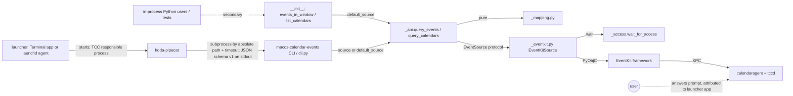

# Task: macos-calendar-events v0.1: read-only EventKit window query library and CLI

**Status**: Not Started
**Component**: core
**Assigned to**: Varun Singh (vr000m)
**Priority**: High
**Branch**: `feature/core-events-api`
**Created**: 2026-11-19
**Completed**:
**Review Gates**: none

## Objective

Ship an open-source Python package, `macos-calendar-events` (import name `macos_calendar_events`), that reads macOS Calendar through EventKit, read-only. It returns every event that overlaps a time window, across every calendar the Mac can see, through a JSON CLI with a versioned output schema. That CLI is the stable contract between repos. A Python API with plain JSON-serializable dataclasses is also public, but secondary.

## Context

- **Motivation (consumer, not scope):** koda-pipecat records meetings, diarizes speakers (S1, S2, …), and post-processes each session. It wants to fetch calendar events in a fuzzy window around a recording (for example ±15 min), work out which of several overlapping meetings was actually attended, and use the invitee list as a *non-normative* hint, mostly for spelling speaker names. koda-pipecat integrates by **running the CLI as a subprocess** with a timeout and parsing its versioned JSON. It doesn't import this library, so the two repos share only the CLI and JSON contract (R18). All of that ranking, matching, and LLM reconciliation stays in koda-pipecat. This package only answers "what events overlap [start, end)?" accurately and completely.
- **Why a separate repo:** it's reusable outside koda, it's open source, and it keeps PyObjC/EventKit and macOS privacy (TCC) concerns out of the consumer.
- **Data reality (assumption, checked in Phase 0):** the user's Calendar.app aggregates several accounts (work Exchange/Google, personal iCloud, shared and subscribed calendars). The default `EKEventStore` is assumed to expose them all, so "all calendars" is the default. Delegate calendars (`delegateSources`) may be excluded. Phase 0 measures this, and any gap becomes a documented limitation.
- **Repo state (snapshot 2026-11-19 15:30 PST):** branch `feature/core-events-api` (from `main` at `4568144 Initial commit`), containing plan commits plus a `.gitignore` update that ignores `/.review-plan`. Files: `LICENSE` (**BSD 2-Clause**, © 2026 Varun Singh), stock Python `.gitignore` (ignores `.venv`, `.mypy_cache`; `uv.lock` stays tracked), this plan. No `pyproject.toml` yet.
- **Dev machine:** macOS 26.6.2. Two uv binaries are installed: `/opt/homebrew/bin/uv` 0.13.9, first on PATH in login shells and so the one `uv run` uses interactively, and `~/.local/bin/uv` 0.9.18. Phase 1 pins `[tool.uv] required-version = ">=0.9"` so either works. Latest `pyobjc-framework-EventKit` on PyPI is 13.0 (`requires_python >=3.11`).

## Requirements

The **Type and Signature Sketch** (Technical Specifications) is the single source for public signatures. R1–R9 must match it.

### Functional
- R1. `events_in_window(start, end, *, calendars=None, include_notes=False, prompt=True) -> list[Event]` returns every event overlapping the half-open window `[start, end)` from all calendars by default. `calendars` optionally restricts the query (R6).
- R2. `list_calendars(*, prompt=True) -> list[CalendarInfo]` returns every event calendar EventKit exposes:
  - `id`, `title`, `source_title`.
  - `source_type`: `SourceType`, mapped from the `EKSourceType` int; unknown ints become `unknown`.
  - `color_hex`: `#RRGGBB` in sRGB, or `None` if conversion fails.
  - `read_only`: `not EKCalendar.allowsContentModifications`.

  Calendars are sorted by `(source_title, title, id)`.
- R3. `Event` fields:
  - Identity: `id` (opaque string, unique within one response; its format is not part of the contract), `external_id`, `event_identifier`. Documented consumer dedupe key: `(external_id, occurrence_start)`, only when `external_id` is non-null; rows with a null `external_id` are never deduped. This guidance is provisional until Phase 0 reports whether one invite in two calendars actually shares an external id.
  - Content: `title`, `location`, `url`, `notes` (only when `include_notes=True`, else `None`).
  - Time: `start`, `end` (UTC instants, end exclusive, serialized `…Z` with whole seconds), `all_day`, `start_date` / `end_date` (calendar dates `YYYY-MM-DD`, end exclusive, set only for all-day events, otherwise `None`; computed in the adapter), `time_zone` (informational only). For all-day and floating events, the UTC `start`/`end` instants reflect the Mac's system time zone at query time; consumers should use `start_date`/`end_date` for all-day events.
  - State: `status`, `is_recurring` (`hasRecurrenceRules or isDetached`), `is_detached`, `occurrence_start`.
  - People and calendar: `organizer: Participant | None`, `attendees: tuple[Participant, ...]`, `self_status: ParticipationStatus | None`, `calendar: CalendarRef`.

  Nullability is decided up front, because R18 forbids retyping later. `title`, `event_identifier`, `time_zone`, `external_id`, `location`, `url`, `notes`, `start_date` and `end_date` are nullable. `time_zone` is "IANA name when available, otherwise EventKit's raw zone name, `None` for floating". `occurrence_start` falls back to `start` when `occurrenceDate` is nil.
- R4. `Participant`:
  - `name | None`, `email | None`, `url | None`, `role`, `status`, `type` (person/room/resource/group/unknown), `is_self` (`EKParticipant.isCurrentUser`).
  - `email` follows RFC 6068 parsing: scheme compared case-insensitively, `?query` stripped, percent-decoded, first address when several are comma-separated, `None` when empty. `url` is the raw URL **only when it is not `mailto:`**, otherwise `None`.
  - `self_status` is the status of the first `is_self` attendee in EventKit order, or `None` when there isn't one.
- R5. Declined and canceled events **are returned** with their status. Consumers decide what to drop.
- R6. Calendar filter:
  - Each selector matches by exact `calendarIdentifier` first; if any calendar's id matches, title matching is skipped for that selector. Otherwise it matches by title compared with `casefold()`. A title can match several calendars, and all are included.
  - Any selector that matches nothing raises `CalendarNotFoundError` listing available titles, even when other selectors match.
  - `calendars=[]` raises `ValueError`. `None` means all calendars. The filter is **never** silently ignored.
- R7. CLI commands:
  - `macos-calendar-events window --start UTC --end UTC [--calendar X ...] [--pad-minutes N] [--include-notes] [--prompt]`
  - `macos-calendar-events calendars [--prompt]`
  - The CLI **never prompts for Calendar access unless `--prompt` is passed**. There is no `--no-prompt` flag. Without `--prompt`, a `not_determined` status exits 3 immediately. The README tells users to grant access once by running `macos-calendar-events calendars --prompt` from Terminal.
  - `macos-calendar-events --version`, which prints `macos-calendar-events <version> (schema_version 1)`.

  Output is JSON on stdout, diagnostics go to stderr, and exit codes are documented (R11). **The CLI is the primary, documented integration surface** (R18). The Python API (R1, R2, R9) stays public but secondary, for tests and in-process users.
- R8. Output is deterministic: events sorted by `(start, end, calendar.id, id)`, all UTC.

### Permissions (TCC)
- R9. Access API:
  - `authorization_status() -> AccessStatus` returns `not_determined | restricted | denied | full_access | write_only | unknown`. The EventKit int is mapped in `_mapping`, and unknown ints become `unknown`.
  - `request_access(timeout=60.0) -> AccessStatus` uses `requestFullAccessToEventsWithCompletion_` only. `requestAccessToEntityType_completion_` is never called (R19). The wait is the pure helper `_access.wait_for_access(request, read_status, timeout)`, which takes an injected requester. If the completion never fires within `timeout`, it returns the current status.
  - Reads gate on access: `full_access` passes; `not_determined` with `prompt=True` requests once, then re-checks; anything else, including still `not_determined` after the request, raises `CalendarAccessError(status)`.
  - Remediation text is generic: "grant Calendar access to the app that launched this process (for example Terminal, iTerm2, VS Code) in System Settings → Privacy & Security → Calendars". The package doesn't try to detect the responsible app. `write_only` counts as denied for reads.
- R10. No writes, ever. Enforced by `scripts/check_readonly.sh` in CI:
  - `grep -rnE` over `src/` for a denylist: `saveEvent|removeEvent|saveCalendar|removeCalendar|saveReminder|removeReminder|commit_?\(|requestWriteOnlyAccess|requestAccessToEntityType`, plus `\.reset\(`. `reset` is never called (store lifetime rule, Phase 4).
  - Grep's exit code is interpreted strictly: `1` (no match) is a pass, `0` (match) is a fail, and anything else (for example `2` for an unreadable path) is a fail.
  - An **allowlist**: the set of PyObjC selector calls with arguments in `_eventkit.py` (identifiers ending in `_(`) must equal `scripts/eventkit_selectors.allow`.
  - The script is itself tested (Phase 1).

### Boundaries and errors
- R11. CLI exit codes:
  - `0` ok.
  - `1` internal error: a catch-all handler prints one line, `internal error: <ExceptionClass>`, with no traceback and no message text (privacy).
  - `2` usage or argument error, including an over-cap window (R13) and `--pad-minutes < 0`. argparse's usage block is allowed here.
  - `3` calendar access not granted.
  - `4` EventKit unavailable (not macOS, macOS < 14, or PyObjC missing).
  - `5` calendar selector not found.

  Exits 1, 3, 4 and 5 print exactly one stderr line. Every non-zero exit leaves stdout empty, because stdout is written once, after serialization succeeds. A process killed by a signal (for example a TCC refusal, if Phase 0 observes one) is outside the CLI's control. Consumers treat it like any other failure.
- R12. **UTC at the contract boundary, input and output.**
  - **CLI:** `--start`/`--end` must be ISO 8601 UTC, written with `Z` or `+00:00`. Naive values and any non-zero offset exit `2` with a one-line message (e.g. `--start must be UTC (end with Z or +00:00)`). This supersedes the earlier "naive = local" rule.
  - **Python API:** `start`/`end` must be timezone-aware with `utcoffset() == timedelta(0)`. Naive or non-zero-offset datetimes raise `ValueError`, for symmetry with the CLI; there is no silent normalization.
  - **Output:** every instant (`start`, `end`, `occurrence_start`, echoed window) is UTC `…Z` with whole seconds.
  - **Consumer's job:** koda converts its session times to UTC before calling. The library never needs the consumer's time zone, and local-time presentation is the consumer's concern.
  - `end <= start` → `ValueError` / exit 2.
- R13. Window span cap: EventKit's `predicateForEventsWithStartDate:endDate:calendars:` only matches events within a four-year span, so over-cap windows raise `ValueError` (CLI exit 2) instead of being silently truncated. The details:
  - **Limit:** the caller's window, measured **after** `--pad-minutes` padding, may be at most **4×365 − 2 days** long.
  - **Widening:** the adapter always queries **±1 day** beyond that padded window, so the queried range stays within EventKit's 4-year span, and the Python overlap filter trims the result back to the window. This is needed because all-day and floating events are date-anchored, so DST and time-zone shifts can move them by up to a day relative to a UTC window.
  - **Length, not age:** the cap limits window **length** only. Windows may be arbitrarily far in the past, for example a crashed cron job reprocessing a week- or month-old session with its absolute UTC times.

  No chunking in v0.1.
- R14. `import macos_calendar_events` succeeds on non-macOS and without PyObjC. EventKit is imported lazily, and only `_eventkit.py` imports `EventKit`/`Foundation`/`AppKit`/`objc` (enforced by `scripts/check_readonly.sh`).

### Packaging and quality
- R15. Packaging and tooling:
  - `pyproject.toml` with a hatchling backend, `uv`-managed, `requires-python = ">=3.11"`, `readme = "README.md"`.
  - Runtime dependency `pyobjc-framework-EventKit>=13; sys_platform == 'darwin'` (the floor is the tested version).
  - ruff (lint and format), mypy `--strict` (one type checker), pytest. `py.typed` shipped.
  - License metadata `BSD-2-Clause`.
  - Classifiers stay generic (`Operating System :: MacOS`, `Environment :: MacOS X`), because no PyPI classifier expresses a macOS version. The macOS 14 Sonoma minimum is stated in the project `description` and README, and enforced at runtime (R19).
- R16. Privacy: no real calendar data in the repo, in test output, or in CI logs.
  - Fixtures are hand-written with RFC 2606 domains (`example.com`, `example.org`).
  - The live smoke test asserts on integer counts only.
  - `scripts/validate_json.py` prints only JSON paths and validator keywords, never values.
  - `scripts/check_privacy.sh` (run in CI) scans every `git ls-files` file case-insensitively for email addresses outside RFC 2606 domains and GitHub noreply addresses. Exit codes: 0 clean, 1 violation, 2 error.
- R17. CI on GitHub Actions:
  - `macos-latest` (Python 3.11 and 3.13) runs ruff, mypy, unit tests (`-m "not live"`), `check_readonly.sh` and `check_privacy.sh`.
  - `ubuntu-latest` (Python 3.12) runs unit tests only, to prove R14 without PyObjC; darwin-only tests skip.
  - No live calendar access in CI.

### Cross-repo contract (CLI + JSON)
- R18. **CLI JSON contract.**
  - **Schemas:** the stdout of `window` and `calendars` is specified by JSON Schemas shipped as **package data**: `src/macos_calendar_events/schema/window-v1.schema.json` and `calendars-v1.schema.json`, loaded via `importlib.resources`, so installed consumers and tests read the same files. Each schema declares `$schema: https://json-schema.org/draft/2020-12/schema`, a stable `$id` (`https://github.com/vr000m/macos-calendar-events/schema/<name>-v1.json`) and `schema_version: {const: 1}`.
  - **Serialization:** UTF-8 with `ensure_ascii=False`, `sort_keys=True`, `indent=2` and a trailing newline. Datetimes are RFC 3339 with whole seconds (`timespec="seconds"`); raw timestamps are truncated to whole seconds at the `Raw*` boundary.
  - **Stability rules within v1:** fields may be **added** (consumers must ignore unknown keys), but none are removed, renamed, retyped, or changed in meaning. **Enums are open within v1:** a new enum value is an additive change. Schema enum fields are `type: string` with their known values listed in an `x-known-values` annotation and the field `description`, and consumers map unknown values to `unknown`. Any breaking change bumps `schema_version` to 2 with new schema files.
  - **Enforcement:** contract tests (Phase 5) validate CLI output against the schemas, with format checking on, and compare it byte for byte with golden files `tests/golden/window-v1.json` and `tests/golden/calendars-v1.json`. Goldens are the **single stated exception** to "expected values never come from running the code". They are change detectors generated by `scripts/regen_goldens.py`, hand-reviewed before commit, and any golden change needs a `CHANGELOG.md` line. Phase 2's hand-written expected values remain the independent correctness check.
  - **Documented consumer rule (README):** call the CLI by absolute path with a timeout (suggested 10 s), and treat any non-zero exit, signal, timeout, missing executable, or JSON/schema/`schema_version` mismatch as "no calendar hints". Never treat it as fatal for the consumer's own pipeline. **Install and locate:** the supported install is `uv tool install git+https://github.com/vr000m/macos-calendar-events@v0.1.0` (a pinned tag), which puts the CLI in `~/.local/bin`. A launchd agent's PATH doesn't include `~/.local/bin`, so consumers invoke the CLI by absolute path. koda reads it from config/env (e.g. `KODA_CALENDAR_CLI`, default `~/.local/bin/macos-calendar-events`) and treats `FileNotFoundError` as "no hints".
  - **Performance:** a cold-process startup of ~100–200 ms (Python + PyObjC import) per call is acceptable. Startup optimization is out of scope.
- R19. **macOS 14 (Sonoma) or newer only.** `default_source()` gates on feature detection, `EKEventStore.instancesRespondToSelector_("requestFullAccessToEventsWithCompletion:")`, rather than parsing `platform.mac_ver()`. If the selector is missing, it raises `EventKitUnavailableError` (CLI exit `4`), quoting `platform.mac_ver()[0]` in the message for information only. There are no code paths for older macOS.

## Non-Goals

- Ranking, scoring, fuzzy matching, or choosing "the" meeting. No LLM calls. (These belong to koda-pipecat.)
- Writing, editing, or deleting events, reminders (`EKEntityTypeReminder`), alarms, or attachments.
- Non-EventKit sources (ICS URLs, CalDAV, Google/Microsoft APIs). A future `calendar-window`-style multi-backend is out of scope.
- Change notifications (`EKEventStoreChangedNotification`), result caching, daemons.
- Detecting calendars that are *hidden* (unchecked) in Calendar.app. EventKit doesn't expose that view state, so hidden-but-subscribed calendars are returned. This is documented, and the `calendars` filter is the workaround.
- Delegate calendars, if Phase 0 shows the default store excludes them (documented limitation; `initWithSources:` is a follow-up).
- Detecting which app TCC attributes a request to (remediation text is generic, R9).
- Converting to or presenting local time (the consumer's concern; R12).
- Windows over the R13 cap, Python < 3.11, macOS < 14 (R19), publishing to PyPI (release is a follow-up plan).
- Optimizing CLI startup latency or running a resident server/daemon for consumers (R18 accepts ~100–200 ms per call).
- Merging duplicate rows when one invite appears in several calendars. Rows stay separate; consumers dedupe on `(external_id, occurrence_start)` when `external_id` is non-null (R3).

## Review Focus

- **EventKit contracts** (Apple Developer docs):
  - `EKEventStore.requestFullAccessToEventsWithCompletion:` (macOS 14+; the only request API used).
  - `EKAuthorizationStatus` values (`FullAccess`=3 replaced `Authorized` on 14+, `WriteOnly`=4).
  - `predicateForEventsWithStartDate:endDate:calendars:` four-year limit and its edge behavior (measured in Phase 0). `eventsMatchingPredicate:` expands recurring occurrences.
  - `EKEvent.occurrenceDate`, `isDetached`, `hasRecurrenceRules`, `calendarItemExternalIdentifier` (may be nil, shared across occurrences, or differ across accounts), `eventIdentifier`.
  - `EKParticipant.URL`, `participantRole/Status/Type`, `isCurrentUser`.
  - `EKSourceType`, `EKCalendar.allowsContentModifications`, `EKCalendar.color`.
  - Whether a store created before the grant returns data after it.
- **TCC attribution:** a CLI run from Terminal is attributed to the *responsible app* (Terminal, iTerm2, VS Code; cron or launchd → none). Because koda runs the CLI as a **subprocess**, attribution follows koda's own responsible process: a Terminal-launched koda, or a launchd agent with no app. The prompt needs `NSCalendarsFullAccessUsageDescription` in the responsible app's Info.plist. **This is the highest risk and is de-risked in Phase 0 before any design is frozen.**
- **Completion-handler threading:** the completion block fires on an arbitrary queue. `_access.wait_for_access` blocks on `threading.Event` with a timeout; Phase 0 decides whether an `NSRunLoop` must be pumped.
- **Time:** UTC-only input and output (R12); RFC 3339 `…Z` with whole seconds; DST transitions; floating (no-tz) events; all-day `start_date`/`end_date` exclusivity; ±1-day query widening (R13); `time_zone` passed through as informational, including non-IANA names such as `GMT+0530`.
- **Cross-repo contract:** JSON Schema draft 2020-12 with format checking, additive-only evolution within `schema_version` 1.
- **Formats:** RFC 6068 (`mailto:`), RFC 3986 scheme case-insensitivity, RFC 2606 fixture domains.
- **Overlap semantics** at boundaries, including zero-duration events.

## Architecture & Call Flow

> **Confirmed by the user 2026-11-19**, with one override: koda-pipecat integrates through a **CLI subprocess**, not a library import (see Decisions). Independently executing components:
> - the launcher (Terminal or launchd), which determines TCC attribution;
> - the koda-pipecat process;
> - the CLI subprocess, which hosts this library and Apple's EventKit framework in-process;
> - the out-of-process calendar agent plus TCC daemon.
>
> `cli.py` calls `_api.query_events(source or default_source(), …)` directly, so its injected test source works. The public `events_in_window` / `list_calendars` in `__init__` are thin wrappers over the same `_api` functions, with `default_source()`.



```mermaid
sequenceDiagram
    participant K as koda-pipecat
    participant C as CLI subprocess
    participant D as default_source()
    participant A as _api
    participant S as EventKitSource
    participant T as tccd / calendaragent
    participant M as _mapping
    K->>C: spawn `window --start <UTC> --end <UTC> --pad-minutes 15` (no --prompt; timeout)
    C->>D: default_source()
    D-->>C: EventKitUnavailableError → exit 4 (if no EventKit / macOS < 14)
    C->>A: query_events(source, start, end, calendars, include_notes, prompt)
    A->>M: validate_window(start, end)  (ValueError on naive / non-UTC / inverted / over cap → exit 2)
    A->>S: authorization_status() (raw int)
    A->>M: access_status_from_int(int)
    alt not_determined and prompt
        S->>T: requestFullAccessToEvents (wait_for_access ≤ timeout)
        T-->>S: granted / denied / no callback
        A->>S: authorization_status() (re-check)
    end
    A-->>C: CalendarAccessError if not full_access → exit 3
    A->>S: calendars()
    A->>M: select_calendars(raw_calendars, selectors)  (CalendarNotFoundError → exit 5)
    A->>S: events(padded_start − 1 day, padded_end + 1 day, calendar_ids)
    S-->>A: list[RawEvent]  (plain Python, no ObjC objects)
    A->>M: to_events(raw, window, include_notes)  (map, overlap filter, sort)
    M-->>A: list[Event]
    A-->>C: list[Event]
    C-->>K: stdout JSON (schema_version 1), exit 0
    Note over K,C: non-zero exit / signal / timeout / parse error → koda proceeds with no calendar hints
```

## Implementation Checklist

Each phase ends in a green, checkable state, and the next phase doesn't start until it is. Every `/conduct`-run phase gate (Phases 1–6) ends with the **full CI command** (spelled out literally in each Test command so `/conduct` can run it), so a phase-boundary commit can't be CI-red:

Full gate: `uv run ruff check . && uv run ruff format --check . && uv run mypy && uv run pytest -m "not live" && bash scripts/check_readonly.sh && bash scripts/check_privacy.sh`

Phase-specific pytest paths run first as a fast check. **Live-command preflight:** every live or validation command on the Mac runs from the terminal app that holds the Calendar grant (recorded in Phase 0 Findings). It is preceded by `uv run python -c "import sys, macos_calendar_events as m; s = m.authorization_status(); print(s); sys.exit(s != 'full_access')"`, which fails fast without prompting (available from Phase 4).

### Phase 0: EventKit and TCC spike (human-run; throwaway; decides the design)

**Impl files:** `scripts/spike_eventkit.py`
**Test files:** (none: manual spike)
**Test command:** `uv run --python 3.12 --with pyobjc-framework-EventKit python scripts/spike_eventkit.py --summary`
**Goal:** Turn the riskiest assumptions into observed facts before freezing types. The spike prints **counts and shapes only**, never titles, names, emails, notes, or ids.

- Record the interpreter path, Python version and PyObjC version. Time the bare interpreter + `import EventKit` separately from `uv run` overhead (R18 budget).
- **Permissions:** from Terminal.app and from the user's usual terminal or VS Code, check `authorizationStatusForEntityType_`, call `requestFullAccessToEventsWithCompletion_`, and record whether a prompt appears, which app it names, and the resulting status. Record if the process is killed instead of returning a status.
- **Subprocess attribution (koda's path):** run the spike as a *child process* (a) of a Python parent started from Terminal and (b) of a parent started by a user `launchd` agent (`launchctl bootstrap gui/$UID` with a temporary plist the user loads and unloads). For each, record attribution, whether a prompt can appear, the resulting status, and whether a grant made from Terminal carries over.
- **Run loop:** confirm whether `threading.Event.wait(timeout)` receives the completion without an `NSRunLoop`; if not, record that `NSRunLoop.currentRunLoop().runUntilDate_` slices are required.
- **Store lifetime:** after a first-time grant (on a reset grant, done by the user), compare calendar and event counts from the store created before the grant with those from a fresh store (input to the store-lifetime rule; Phase 0 may relax it to a single store).
- **Predicate edges:** over a real window, compare counts for events ending exactly at, starting exactly at, and zero-length on the window edges between a narrow query and a widened-then-filtered query (informational: the adapter widens by ±1 day regardless, R13).
- **Shapes over a real ±7-day window** (counts only):
  - nil counts for `calendarItemExternalIdentifier`, `title`, `eventIdentifier`, `occurrenceDate`, `timeZone`, source title;
  - `timeZone` names that `zoneinfo.ZoneInfo` rejects;
  - whether recurring occurrences share the external id;
  - whether the same invite in two calendars shares an external id, reported explicitly as "observed / not observed";
  - participant URL scheme distribution;
  - all-day `startDate`/`endDate` representation, and the local calendar dates the adapter would derive for `start_date`/`end_date`;
  - `participantType` values;
  - a `hasRecurrenceRules` × `isDetached` cross-tab, and `occurrenceDate` vs `startDate` on detached events;
  - per source type, how many events have 0, 1 or more `isCurrentUser` attendees, and whether the organizer repeats in `attendees`;
  - calendar color spaces and whether sRGB hex conversion succeeds with the declared dependencies;
  - `delegateSources` count vs default-store sources;
  - `EKSourceType` values seen.
- **Exit checklist (Phase 0 is done only when all hold):**
  - every bullet above has a recorded result in `## Findings` (Phase 0);
  - each design consequence is written into `## Decisions` (as `Decision (Phase 0): …`);
  - if any consequence changes the contract above the marker, the plan is updated via `/dev-plan update` and `/review-plan` re-runs before Phase 1;
  - the architecture-reopen criteria are checked explicitly. **Stop and re-plan the CLI-subprocess architecture only if** (a) the CLI launched under a launchd-started parent can't reach `full_access` by any documented user step (granting from Terminal, or adding the binary in Privacy settings), or (b) the permission completion callback never fires even with the run loop pumped. Every other Phase 0 result updates Phases 2–4 via `/dev-plan update`, followed by a fresh `/review-plan`.
- Commit the spike with its findings (so history keeps it). It is deleted in Phase 1.

### Phase 1: Scaffold, tooling, CI

**Impl files:** `pyproject.toml, uv.lock, README.md, CHANGELOG.md, src/macos_calendar_events/__init__.py, src/macos_calendar_events/py.typed, src/macos_calendar_events/_eventkit.py, .github/workflows/ci.yml, scripts/check_readonly.sh, scripts/eventkit_selectors.allow, scripts/check_privacy.sh`
**Test files:** `tests/test_import.py, tests/test_check_scripts.py`
**Test command:** `uv run pytest tests/test_import.py tests/test_check_scripts.py -v && uv run ruff check . && uv run ruff format --check . && uv run mypy && uv run pytest -m "not live" && bash scripts/check_readonly.sh && bash scripts/check_privacy.sh`
**Validation cmd:** `git push -u origin feature/core-events-api && gh run watch --exit-status` (user-run; pushing is the user's call)
**Goal:** Every later phase lands on a working lint/type/test/guard harness. The package imports without PyObjC.

- Delete `scripts/spike_eventkit.py` (findings are already recorded), so the ruff gate never lints it.
- `pyproject.toml`:
  - hatchling, src layout, package data `schema/*.json` included.
  - `readme = "README.md"`; this phase adds a stub README that Phase 6 fills.
  - `description` states macOS 14+; generic classifiers (R15); `[tool.uv] required-version = ">=0.9"`.
  - `[project.scripts] macos-calendar-events = "macos_calendar_events.cli:main"`. The entry point targets `cli.py`, which first exists in Phase 5. That is accepted, because nothing invokes the script before then.
  - `[dependency-groups] dev = [pytest, ruff, mypy, "jsonschema[format-nongpl]", types-jsonschema]`.
  - ruff config: target py311, `select = ["E","F","I","B","UP","SIM","RUF"]`.
  - mypy: `strict = true`, `files = ["src", "tests"]`, override `ignore_missing_imports` for `EventKit`, `Foundation`, `AppKit`, `objc`.
  - pytest: `markers = ["live: touches the real macOS calendar; opt-in"]`. `uv.lock` committed.
- `CHANGELOG.md` stub (an `Unreleased` section), so golden changes in Phase 5 have somewhere to be logged.
- `_eventkit.py` starts as a three-line stub (lazy `import EventKit` inside a function) so the strict-mypy + PyObjC-as-`Any` assumption is proven now, not in Phase 4.
- `tests/test_import.py` (fresh subprocess via `sys.executable -c`, so the result doesn't depend on test order):
  - with `sys.modules['EventKit'] = sys.modules['Foundation'] = sys.modules['objc'] = None`, `import macos_calendar_events` succeeds and exposes `__version__`;
  - in a normal subprocess, `"EventKit" not in sys.modules` after import.
- `scripts/check_readonly.sh`: the R10 denylist via `grep -rnE` with strict exit-code handling, the selector allowlist comparison, and an R14 check that `import EventKit|Foundation|AppKit|objc` appears only in `_eventkit.py`.
- `scripts/check_privacy.sh`: per R16.
- `tests/test_check_scripts.py` copies each script into a temp tree and runs it:
  - clean tree → exit 0;
  - seeded `store.saveEvent_span_error_(e, 0, None)` → non-zero;
  - seeded `store.reset()` → non-zero;
  - a selector missing from the allowlist → non-zero;
  - `src/` missing → non-zero (proves the exit-2 path fails);
  - seeded `real@Corp.COM` → `check_privacy.sh` exits 1;
  - `a@example.com` → 0.
- CI per R17 (macOS 3.11 and 3.13 run the full gate; ubuntu 3.12 runs `uv run pytest -m "not live"`).

### Phase 2: Domain types, JSON serialization and schemas

**Impl files:** `src/macos_calendar_events/models.py, src/macos_calendar_events/errors.py, src/macos_calendar_events/schema/window-v1.schema.json, src/macos_calendar_events/schema/calendars-v1.schema.json`
**Test files:** `tests/test_models.py, tests/test_schemas.py`
**Test command:** `uv run pytest tests/test_models.py tests/test_schemas.py -v && uv run ruff check . && uv run ruff format --check . && uv run mypy && uv run pytest -m "not live" && bash scripts/check_readonly.sh && bash scripts/check_privacy.sh`
**Goal:** The public data shape is fixed and serializes to one stable JSON form. One module owns serialization and `SCHEMA_VERSION`.

- Frozen, slotted dataclasses and `StrEnum`s per the type sketch. Collections are tuples.
- `models.py` owns `SCHEMA_VERSION = 1`, `window_to_json(events, *, window) -> str` and `calendars_to_json(calendars) -> str`, both using the R18 serialization rules (sort_keys, indent 2, `ensure_ascii=False`, trailing newline, `timespec="seconds"`). Keys are always present, with `None` as `null`.
- Errors: base `MacosCalendarEventsError`; `CalendarAccessError(status: AccessStatus)`, `CalendarNotFoundError(selectors, available_titles)`, `EventKitUnavailableError`.
- Write both JSON Schemas by hand from the type sketch: `$schema`, `$id`, `schema_version: {const: 1}`, required keys, types, nullability per R3, `color_hex` pattern `^#[0-9A-F]{6}$`, `date-time` formats, `additionalProperties: true`. Enum fields are open: `type: string` plus `x-known-values: [...]` and a `description` listing the values (R18). `start_date`/`end_date` use `format: date`, and every instant uses `format: date-time` with a `pattern` requiring a `Z` suffix.
- `tests/test_models.py`:
  - hand-written expected dicts derived from the spec (not from calling the code);
  - a non-ASCII title serializes unescaped;
  - a sub-second datetime serializes with whole seconds;
  - the exact `window_to_json` text for a two-event fixture matches a hand-written string (pins key order and indent);
  - a frozen-mutation attempt raises `FrozenInstanceError`.
- `tests/test_schemas.py`:
  - `Draft202012Validator.check_schema` passes on both files;
  - serializer output validates with `format_checker=Draft202012Validator.FORMAT_CHECKER`;
  - negatives: missing required key, wrong type, naive datetime string, `not-a-date`, `schema_version: 2`;
  - positive: an extra unknown key validates;
  - each schema's `required` equals the dataclass field names for `Event`, `Participant`, `CalendarRef` and `CalendarInfo`;
  - every StrEnum's values equal the `x-known-values` of its schema field (every value documented, nothing stale), and a document with an unknown enum string still validates;
  - an instant with `+02:00` instead of `Z` fails validation.

### Phase 3: Pure core (mapping, access gate, window, selection) against a fake source

**Impl files:** `src/macos_calendar_events/_raw.py, src/macos_calendar_events/_mapping.py, src/macos_calendar_events/_access.py, src/macos_calendar_events/_api.py`
**Test files:** `tests/fakes.py, tests/test_window_query.py, tests/test_calendar_selection.py, tests/test_access.py, tests/test_enum_tables.py, tests/test_mailto.py`
**Test command:** `uv run pytest tests/test_window_query.py tests/test_calendar_selection.py tests/test_access.py tests/test_enum_tables.py tests/test_mailto.py -v && uv run ruff check . && uv run ruff format --check . && uv run mypy && uv run pytest -m "not live" && bash scripts/check_readonly.sh && bash scripts/check_privacy.sh`
**Goal:** All behavior that isn't "talk to EventKit" is pure and is exercised through `_api.query_events(source, …)` / `_api.query_calendars(source, …)` with a `FakeSource`, plus `_access.wait_for_access` with injected callables. No PyObjC is touched. This phase does **not** touch `__init__.py` (wired in Phase 4).

- `_raw.py`: the `EventSource` Protocol and the `RawCalendar` / `RawEvent` / `RawParticipant` records:
  - plain Python: aware UTC datetimes truncated to whole seconds, raw EventKit enum **ints** (including authorization status), strings, `None`;
  - `color_rgb: tuple[float, float, float] | None` already converted to sRGB by the adapter.
- `_mapping.py`: `access_status_from_int`, `source_type_from_int`, `event_status_from_int`, role/status/type tables (unknown int → `UNKNOWN`), `parse_mailto`, `rgb_to_hex`, `validate_window`, `select_calendars`, `overlaps`, `map_participant`, `map_calendar`, `map_event`, `to_events` (map → overlap filter → sort), `to_calendars` (map → sort).
- `_access.py`: `wait_for_access(request: Callable[[Callable[[bool, object | None], None]], None], read_status: Callable[[], int], timeout: float) -> int`, built on a stdlib `threading.Event`.
- `_api.py`: `query_events(source, start, end, *, calendars, include_notes, prompt)` and `query_calendars(source, *, prompt)`: access gate (R9) → select → fetch → map.
- Named fixture-driven tests, each asserting observable output:
  - **overlap:** event ends exactly at window start → excluded; starts exactly at window end → excluded; spans the whole window → included; zero-duration at window start → included, at window end → excluded.
  - **recurring:** two occurrences of one series → distinct `id`, same `event_identifier`, same `external_id`, `is_recurring=True`; a detached occurrence keeps the id derived from its original `occurrence_start`; nil `occurrenceDate` → `occurrence_start == start`.
  - **all-day:** single-day and three-day all-day events at both window edges; `all_day=True`; `start_date`/`end_date` passed through from the raw record with an exclusive end; `time_zone=None`; timed events have `start_date is None`.
  - **floating:** a timed event with `time_zone=None`.
  - **DST:** an event across the US spring-forward and fall-back boundaries keeps correct UTC instants, serialized with `Z`; `time_zone` passed through unchanged.
  - **declined:** self attendee `declined` → returned with `self_status == DECLINED`; canceled → `status == CANCELED`.
  - **self rows:** zero `is_self` attendees → `self_status is None`; two → the first in order wins.
  - **attendees:** non-mailto URL → `email=None`, `url` kept; mailto → `url is None`; no name → `name=None`; organizer-only → `attendees == ()`; room → `type == ROOM`.
  - **nulls:** nil `title`, `event_identifier`, `external_id` → `null` in output, and `id` still unique.
  - **same invite in two calendars** → two rows, distinct `id`.
  - **mailto (`tests/test_mailto.py`):** `mailto:a@example.com`, `MAILTO:a@example.com`, `mailto:a%40example.com`, `mailto:a@example.com?subject=x`, bare `mailto:` → `None`, `mailto:a@example.com,b@example.com` → first.
  - **enum tables (`tests/test_enum_tables.py`):** every known int per table plus one unknown int → `UNKNOWN`; authorization ints 0–4 plus unknown. A darwin-only, non-live test (`skipif(sys.platform != "darwin")`; constants need no TCC grant) asserts table keys equal `EventKit.EKParticipantStatusAccepted` and its peers, `EKAuthorizationStatusFullAccess`, `EKSourceTypeExchange`, and so on.
  - **calendars (R2):** each `CalendarInfo` field from a raw calendar; `read_only=True` calendar; `color_rgb=None` → `color_hex=None`; `(0.0, 0.5, 1.0)` → `#0080FF`; unknown source-type int → `unknown`; calendar ordering.
  - **selection (R6):** id match; case-insensitive title match; duplicate titles across sources both selected; a selector equal to one calendar's id and another's title selects by id only; one valid + one unknown selector → `CalendarNotFoundError`; `calendars=[]` → `ValueError`; `None` → all.
  - **window validation:** naive → `ValueError`; `end <= start` → `ValueError`; non-UTC aware datetime (`+05:30`) → `ValueError`; a window of exactly 4×365 − 2 days passes and one second more raises; a multi-week window (6 weeks) passes; an old absolute window (`2025-01-06T17:00:00Z`–`2025-01-06T18:00:00Z`) passes and returns its fixture events.
  - **query widening:** `FakeSource` records the range it was asked for, which equals the padded window ±1 day (an effect on the outside system); an all-day event whose UTC instants fall just outside the window but within the widened range is fetched, then included or excluded strictly by `overlaps`.
  - **access gate (`tests/test_access.py`):**
    - each `AccessStatus` from the fake: only `full_access` proceeds; `not_determined` + `prompt=False` raises with zero recorded requests;
    - `not_determined` + `prompt=True` records exactly one request, then: granted → proceeds; denied → raises `CalendarAccessError(DENIED)`; still `not_determined` → raises `CalendarAccessError(NOT_DETERMINED)`;
    - `wait_for_access` with a requester that calls back `True` from another thread → returns the post-grant status; calls back `False` → returns denied status; never calls back → returns the current status after `timeout` (elapsed < timeout + 0.5 s).
  - **raw dates:** `RawEvent.start_date`/`end_date` (adapter-computed `date | None`) carry straight through to output.
  - **empty:** zero events → `[]`; `include_notes=False` → `notes is None` even when raw notes exist.
  - **ordering (R8):** fixtures that tie at each sort-key level assert a hand-written expected order.

### Phase 4: EventKit adapter, platform gate and public API wiring

**Impl files:** `src/macos_calendar_events/_eventkit.py, src/macos_calendar_events/__init__.py, scripts/eventkit_selectors.allow`
**Test files:** `tests/test_eventkit_adapter.py, tests/test_platform_guard.py, tests/test_live_smoke.py`
**Test command:** `uv run pytest tests/test_eventkit_adapter.py tests/test_platform_guard.py -v && uv run ruff check . && uv run ruff format --check . && uv run mypy && uv run pytest -m "not live" && bash scripts/check_readonly.sh && bash scripts/check_privacy.sh`
**Validation cmd:** `MACOS_CALENDAR_EVENTS_LIVE=1 uv run pytest -m live -v` (after the live preflight)
**Goal:** A thin translation from EventKit objects to `Raw*` records. Decisions live in `_mapping` and waiting lives in `_access`; the adapter's remaining branches run in CI against a stub store. Only this module imports PyObjC.

- `EventKitSource(store_factory=…)` implements `EventSource`:
  - the default factory builds a real `EKEventStore`; tests inject a stub;
  - **store lifetime:** the store is created lazily on first use; after a `request_access` that returns `full_access`, the source discards it and builds a fresh store; `reset` is never called (Phase 0 may relax this to a single store if before/after counts match);
  - `authorization_status()` returns the raw int;
  - `request_access(timeout)` calls `_access.wait_for_access` with `store.requestFullAccessToEventsWithCompletion_`, using the run-loop strategy from Phase 0;
  - `calendars()` uses `calendarsForEntityType_(EKEntityTypeEvent)`, with NSColor → sRGB via `colorUsingColorSpace_(NSColorSpace.sRGBColorSpace())`, `None` on failure;
  - `events(start, end, calendar_ids)` resolves ids via `calendarWithIdentifier_` and queries the predicate, with `calendars=None` meaning all, over the padded window ±1 day (R13).
- NSDate ↔ datetime via `timeIntervalSince1970` (truncated to whole seconds, UTC-aware). The `NSTimeZone.name()` string is passed through raw as informational `time_zone`. For all-day events, the adapter computes `start_date`/`end_date` (exclusive end) from the event's dates via `NSCalendar.currentCalendar()` components, normalizing an inclusive `23:59:59` end to the next day per Phase 0 findings. Nil → `None`. Participant URL → `absoluteString()`.
- `default_source()`: one cached `EventKitSource` per process (`_clear_default_source()` for tests). Raises `EventKitUnavailableError` on non-darwin, `ImportError`, or the missing 14+ selector (R19).
- `__init__.py`: wire `events_in_window`, `list_calendars`, `authorization_status`, `request_access` as thin wrappers over `_api` / `default_source()`, plus re-exports of models, errors and `__version__`.
- `scripts/eventkit_selectors.allow`: the exact selector set used.
- `tests/test_eventkit_adapter.py` (stub store; runs where `objc` is absent by stubbing the factory, and NSDate conversion tests are darwin-only):
  - `request_access` with a stub that never calls back returns the current status within the timeout;
  - calendar-id resolution passes only the selected stub calendars to the predicate;
  - an unknown id is skipped (selection already validated);
  - after a stub `request_access` returns full access, the next read uses a newly built stub store (factory called twice); after denial, no new store is built.
- `tests/test_platform_guard.py`: a stub store class without the 14+ selector → `EventKitUnavailableError` whose message includes the version string; with the selector → a source; non-darwin (monkeypatched `sys.platform`) → `EventKitUnavailableError`; blocked `EventKit` import → `EventKitUnavailableError`.
- Live smoke (`@pytest.mark.live`, skipped unless `MACOS_CALENDAR_EVENTS_LIVE=1` **and** darwin), over now ± 7 days: compute violation **counts** (non-aware datetimes, `start > end`, non-overlapping rows, empty ids, duplicate ids, JSON or schema failures) and assert each equals 0; `len(list_calendars()) > 0`. Print only counts.

### Phase 5: CLI and contract tests

**Impl files:** `src/macos_calendar_events/cli.py, scripts/validate_json.py, scripts/regen_goldens.py`
**Test files:** `tests/test_cli.py, tests/test_cli_contract.py, tests/test_validate_json.py, tests/golden/window-v1.json, tests/golden/calendars-v1.json`
**Test command:** `uv run pytest tests/test_cli.py tests/test_cli_contract.py tests/test_validate_json.py -v && uv run ruff check . && uv run ruff format --check . && uv run mypy && uv run pytest -m "not live" && bash scripts/check_readonly.sh && bash scripts/check_privacy.sh`
**Validation cmd:** (after the live preflight) `uv run macos-calendar-events calendars | uv run python scripts/validate_json.py calendars-v1 && uv run macos-calendar-events window --start "$(date -u -v-1d +%Y-%m-%dT%H:%M:%SZ)" --end "$(date -u -v+1d +%Y-%m-%dT%H:%M:%SZ)" | uv run python scripts/validate_json.py window-v1`
**Goal:** The CLI is a thin shell and the stable cross-repo contract: parse → `_api` → serialize → map exceptions to exit codes (R11). Its stdout always validates against the v1 schemas (R18). It has no logic of its own beyond padding and UTC input validation.

- `main(argv: Sequence[str] | None = None, *, source: EventSource | None = None) -> int` calls `_api.query_events(source or default_source(), …)`. `source` is the test seam and isn't a CLI flag. The module ends with `if __name__ == "__main__": sys.exit(main())`.
- A catch-all handler maps unexpected exceptions to exit 1 with a one-line class-only message. stdout is written once, as UTF-8 bytes to `sys.stdout.buffer`, after serialization succeeds.
- `window`: `--start`, `--end` (ISO 8601 UTC only: `Z` or `+00:00`, R12), `--calendar` (repeatable), `--pad-minutes N` (int ≥ 0, widens both ends before cap validation), `--include-notes`, `--prompt`. Output: `window_to_json` with the padded window echoed. `calendars`: `calendars_to_json`. `--version`.
- `scripts/validate_json.py <schema-name>`: loads the packaged schema, validates stdin with the format checker, prints only the JSON path and keyword on failure, and exits non-zero. `tests/test_validate_json.py` feeds an invalid document containing a sentinel string and asserts the sentinel is absent from output.
- `scripts/regen_goldens.py` writes `tests/golden/*.json` from fixed fake fixtures (which include a non-ASCII title). Workflow: run `uv run python scripts/regen_goldens.py`, hand-review the diff against Phase 2's hand-written expected values and the spec, add a `CHANGELOG.md` line, then commit (R18).
- `tests/test_cli_contract.py` (R18):
  - `main([...], source=FakeSource(fixed fixtures))` stdout validates against the schema and equals the golden file byte for byte;
  - every error exit leaves stdout empty;
  - real subprocesses `[sys.executable, "-m", "macos_calendar_events.cli", …]` and the installed `macos-calendar-events` script (found via the venv `bin/`): `--help` exits 0; an unparseable `--start` exits 2 with empty stdout; `--version` prints the version and schema_version.
- `tests/test_cli.py`, via `main([...], source=FakeSource(...))` + `capsys`:
  - stdout parses as JSON with the expected events;
  - `--pad-minutes 15` includes an event 10 min before `--start`; `--pad-minutes -1` → exit 2; padding that pushes the window over the cap → exit 2;
  - `--include-notes` emits notes, and its absence emits `null`;
  - two `--calendar` flags restrict output; an unknown `--calendar` → exit 5;
  - prompt wiring, with `FakeSource` at `not_determined`: without `--prompt`, both `window` and `calendars` exit 3 with **zero** recorded requests; with `--prompt`, exactly one request is recorded; `--no-prompt` is rejected by argparse (exit 2);
  - each error class → its exit code, with one stderr line for 1/3/4/5 (argparse exits use `pytest.raises(SystemExit)`);
  - `end <= start` → 2;
  - UTC input (R12): `Z` and `+00:00` are accepted; a naive value and `+05:30` each exit 2 with the one-line UTC message and empty stdout; output instants all end in `Z`;
  - an old absolute window (`--start 2025-01-06T17:00:00Z --end 2025-01-06T18:00:00Z`) and a 6-week window both exit 0 with the fixture events.
- **Manual validation (user-run, last in this phase):**
  - from a user launchd agent, run the installed CLI by absolute path (no `--prompt`); record exit code and status;
  - then `tccutil reset Calendar <terminal-bundle-id>`, followed by `uv run python -c "import macos_calendar_events as m; print(m.request_access())"`; record prompt, grant and deny behavior;
  - re-grant before marking the phase done.

### Phase 6: Docs and release readiness (no publish)

**Impl files:** `README.md, CHANGELOG.md`
**Test files:** (none)
**Test command:** `uv run ruff check . && uv run ruff format --check . && uv run mypy && uv run pytest -m "not live" && bash scripts/check_readonly.sh && bash scripts/check_privacy.sh`
**Validation cmd:** `uv build && uvx --from dist/*.whl macos-calendar-events --version && uv tool install --force . && ~/.local/bin/macos-calendar-events --version`
**Goal:** A stranger can install it, grant permission, and run it from the README alone. Every README command except `tccutil reset` is executed verbatim on the Mac before this phase is marked done. The reset command is exempt because it revokes the grant the live checks need.

- README sections:
  - what/why (consumer use case in one paragraph, ranking explicitly out of scope);
  - **requirements: macOS 14 Sonoma+**;
  - install: `uv tool install git+https://github.com/vr000m/macos-calendar-events@v0.1.0`, with the CLI landing in `~/.local/bin`, and a note that launchd's PATH lacks `~/.local/bin`, so callers should use the absolute path;
  - permission walkthrough: the generic responsible-app explanation, the System Settings path, the one-time grant via `macos-calendar-events calendars --prompt` run from Terminal, and how to reset during development with `tccutil reset Calendar <bundle-id>` (run by the user, never by the tool);
  - **"Integrating from another program" (primary):** absolute-path subprocess call with a timeout, the R18 stability rules and the "any failure = no hints" rule, a link to the packaged schemas, UTC-only input (convert session times to UTC before calling), the dedupe key `(external_id, occurrence_start)` when `external_id` is non-null (provisional per Phase 0), and the fact that `id` is opaque;
  - CLI examples; Python API example (secondary); exit codes (R11, including 1);
  - known limitations: hidden calendars, delegate calendars if applicable, the R13 cap, external-id caveats, floating times, non-IANA zone names;
  - privacy note; BSD-2-Clause.
- The `v0.1.0` tag that the install command pins is created by the user on `main` after merge (user-run; pushing a tag is the user's call). Until then, README examples are validated with `uv tool install --force .` from the checkout.
- A short consumer snippet: `CLI_PATH = os.environ.get("KODA_CALENDAR_CLI", os.path.expanduser("~/.local/bin/macos-calendar-events"))`; `subprocess.run([CLI_PATH, "window", "--start", t0_utc, "--end", t1_utc, "--pad-minutes", "15"], capture_output=True, timeout=10)`, with `FileNotFoundError`/`TimeoutExpired`/non-zero/`json.JSONDecodeError` all mapped to "no hints", then a `schema_version` check, dedupe on `(external_id, occurrence_start)` for non-null `external_id`, and reconcile in your own code.

## Technical Specifications

### Files to Modify
- `.gitignore`: no change expected (already covers `.venv`, `.mypy_cache`, `dist/`, `/.review-plan`; `uv.lock` stays tracked).

### New Files to Create
- `pyproject.toml`, `uv.lock`, `README.md` (stub in Phase 1, full in Phase 6): packaging and tooling.
- `src/macos_calendar_events/__init__.py`: public API wrappers (Phase 4) and re-exports.
- `src/macos_calendar_events/models.py`: domain dataclasses, enums, `SCHEMA_VERSION`, `window_to_json`, `calendars_to_json`.
- `src/macos_calendar_events/errors.py`: exception hierarchy.
- `src/macos_calendar_events/_raw.py`: `EventSource` Protocol and `Raw*` records (adapter contract).
- `src/macos_calendar_events/_mapping.py`: pure functions, including all EventKit int → enum tables.
- `src/macos_calendar_events/_access.py`: `wait_for_access` (stdlib only).
- `src/macos_calendar_events/_api.py`: orchestration over an `EventSource`.
- `src/macos_calendar_events/_eventkit.py`: the only PyObjC importer.
- `src/macos_calendar_events/cli.py`: argparse CLI.
- `src/macos_calendar_events/schema/window-v1.schema.json`, `src/macos_calendar_events/schema/calendars-v1.schema.json`: the cross-repo JSON contract (R18), shipped as package data.
- `src/macos_calendar_events/py.typed`
- `tests/fakes.py`, `tests/test_*.py`, `tests/golden/*.json`: fakes, tests, goldens (fictional data only).
- `scripts/check_readonly.sh`, `scripts/eventkit_selectors.allow`, `scripts/check_privacy.sh`, `scripts/validate_json.py`, `scripts/regen_goldens.py`; `scripts/spike_eventkit.py` (Phase 0 only, deleted in Phase 1).
- `.github/workflows/ci.yml`, `CHANGELOG.md`.

### Type and Signature Sketch

This sketch is the single source for public signatures.

```python
# models.py
SCHEMA_VERSION: Final = 1
class AccessStatus(StrEnum): NOT_DETERMINED="not_determined"; RESTRICTED="restricted"; DENIED="denied"; FULL_ACCESS="full_access"; WRITE_ONLY="write_only"; UNKNOWN="unknown"
class EventStatus(StrEnum): NONE="none"; CONFIRMED="confirmed"; TENTATIVE="tentative"; CANCELED="canceled"; UNKNOWN="unknown"
class ParticipationStatus(StrEnum): UNKNOWN="unknown"; PENDING="pending"; ACCEPTED="accepted"; DECLINED="declined"; TENTATIVE="tentative"; DELEGATED="delegated"; COMPLETED="completed"; IN_PROCESS="in_process"
class ParticipantRole(StrEnum): UNKNOWN="unknown"; REQUIRED="required"; OPTIONAL="optional"; CHAIR="chair"; NON_PARTICIPANT="non_participant"
class ParticipantType(StrEnum): UNKNOWN="unknown"; PERSON="person"; ROOM="room"; RESOURCE="resource"; GROUP="group"
class SourceType(StrEnum): LOCAL="local"; EXCHANGE="exchange"; CALDAV="caldav"; MOBILEME="mobileme"; SUBSCRIBED="subscribed"; BIRTHDAYS="birthdays"; UNKNOWN="unknown"

@dataclass(frozen=True, slots=True)
class Participant:
    name: str | None; email: str | None; url: str | None     # url is None when the participant URL is mailto:
    role: ParticipantRole; status: ParticipationStatus; type: ParticipantType; is_self: bool

@dataclass(frozen=True, slots=True)
class CalendarRef:
    id: str; title: str; source_title: str | None

@dataclass(frozen=True, slots=True)
class CalendarInfo:
    id: str; title: str; source_title: str | None; source_type: SourceType
    color_hex: str | None   # "#RRGGBB" (sRGB) or None
    read_only: bool         # not allowsContentModifications
    def to_dict(self) -> dict[str, object]: ...

@dataclass(frozen=True, slots=True)
class Event:
    id: str                         # opaque; unique within one response (format not part of the contract)
    external_id: str | None         # calendarItemExternalIdentifier
    event_identifier: str | None    # EKEvent.eventIdentifier; shared by occurrences of a series
    title: str | None
    start: datetime; end: datetime  # UTC; end exclusive; whole seconds; serialized …Z
    all_day: bool
    start_date: date | None; end_date: date | None   # all-day only; end exclusive; computed in the adapter
    time_zone: str | None           # informational: IANA when available, else raw EventKit name; None = floating
    location: str | None; url: str | None; notes: str | None
    status: EventStatus
    is_recurring: bool; is_detached: bool
    occurrence_start: datetime      # occurrenceDate, falling back to start
    organizer: Participant | None
    attendees: tuple[Participant, ...]
    self_status: ParticipationStatus | None
    calendar: CalendarRef
    def to_dict(self) -> dict[str, object]: ...

def window_to_json(events: Sequence[Event], *, window: tuple[datetime, datetime]) -> str: ...
def calendars_to_json(calendars: Sequence[CalendarInfo]) -> str: ...

# _raw.py  (adapter boundary; no ObjC types cross it)
class EventSource(Protocol):
    def authorization_status(self) -> int: ...               # raw EKAuthorizationStatus
    def request_access(self, timeout: float) -> int: ...     # raw status after the wait
    def calendars(self) -> Sequence[RawCalendar]: ...
    def events(self, start: datetime, end: datetime, calendar_ids: Sequence[str] | None) -> Sequence[RawEvent]: ...

# _access.py  (stdlib only)
def wait_for_access(request: Callable[[Callable[[bool, object | None], None]], None],
                    read_status: Callable[[], int], timeout: float) -> int: ...

# _mapping.py  (pure)
def access_status_from_int(value: int) -> AccessStatus: ...
def parse_mailto(url: str) -> str | None: ...
def validate_window(start: datetime, end: datetime) -> None: ...          # aware, utcoffset()==0, end > start, length <= 4*365-2 days
def query_range(start: datetime, end: datetime) -> tuple[datetime, datetime]: ...  # (start - 1 day, end + 1 day)
def select_calendars(cals: Sequence[RawCalendar], selectors: Sequence[str] | None) -> list[RawCalendar]: ...
def overlaps(ev_start: datetime, ev_end: datetime, w_start: datetime, w_end: datetime) -> bool: ...
def to_events(raw: Sequence[RawEvent], window: tuple[datetime, datetime], *, include_notes: bool) -> list[Event]: ...
def to_calendars(raw: Sequence[RawCalendar]) -> list[CalendarInfo]: ...

# _api.py
def query_events(source: EventSource, start: datetime, end: datetime, *, calendars: Sequence[str] | None,
                 include_notes: bool, prompt: bool) -> list[Event]: ...
def query_calendars(source: EventSource, *, prompt: bool) -> list[CalendarInfo]: ...

# __init__.py  (public; thin wrappers over _api with default_source())
def events_in_window(start: datetime, end: datetime, *, calendars: Sequence[str] | None = None,
                     include_notes: bool = False, prompt: bool = True) -> list[Event]: ...
def list_calendars(*, prompt: bool = True) -> list[CalendarInfo]: ...
def authorization_status() -> AccessStatus: ...
def request_access(timeout: float = 60.0) -> AccessStatus: ...
```

**Overlap rule:** `ev_start < w_end and ev_end > w_start`, plus the zero-duration case `ev_start == ev_end and w_start <= ev_start < w_end`. A Python filter can only remove rows, so completeness depends on the queried range being a superset of the window, which `query_range` guarantees by widening ±1 day (R13): date-anchored all-day and floating events can shift by up to a day relative to a UTC window.

### Architecture Decisions
- **Adapter returns plain `Raw*` records (chosen) vs mapping over PyObjC objects (rejected).** B gives each piece of state one owner (EventKit facts in `_eventkit`, decisions in `_mapping`, waiting in `_access`), makes fakes trivial, and keeps ObjC out of the public surface. The adapter is not branch-free: its remaining branches (store lifetime, calendar-id resolution, timeout path) are unit-tested against an injected stub store, and only the PyObjC getter calls are left to the live smoke test.
- **Return declined/canceled, never filter:** the consumer has context we lack (it may have attended a declined meeting).
- **CLI subprocess is the cross-repo contract (user override, 2026-11-19).** Consumers depend on a versioned JSON document plus exit codes, not on Python types. That means koda never needs PyObjC in its environment, a crash or hang in EventKit can't take koda down, and internals can change freely within `schema_version` 1. The cost is ~100–200 ms startup per call, which is fine for once-per-session use.
- **Separate rows per calendar:** the library never merges duplicates. `external_id` is exposed, and consumers dedupe on `(external_id, occurrence_start)` when `external_id` is non-null.
- **macOS 14+ only, by feature detection:** one permission API, no deprecated code path, nothing untested.
- **Reject rather than chunk over-cap windows** (subtract before you add; no observed need).
- **Prompting:** the library defaults to `prompt=True` for interactive Python users. The CLI prompts only with `--prompt`, because its main caller is a non-interactive subprocess with a 10 s timeout, and a prompt that can wait 60 s would guarantee a timeout under launchd.
- **UTC-only boundary (user override):** input and output are UTC, so goldens are byte-stable on any machine, the library never needs the consumer's time zone, and no zone-name lookup can fail.
- **Open enums:** Apple adds EventKit enum values (e.g. `FullAccess`/`WriteOnly` in macOS 14); open enums keep such additions within v1.
- **Fresh store after grant, never `reset`:** safe whichever way Phase 0's store comparison comes out, and it keeps `reset` on the banned list.
- **`notes` opt-in:** notes often carry dial-in codes and passcodes. koda passes `--include-notes` when it wants them for meeting matching.
- **Schemas as package data:** one copy, readable by installed consumers and by tests.
- **One type checker (mypy strict):** pyright would duplicate the gate.

### Dependencies
- Runtime: `pyobjc-framework-EventKit>=13; sys_platform == 'darwin'` (brings `pyobjc-core`, `pyobjc-framework-Cocoa`, which includes AppKit for `NSColor`).
- Dev: `pytest`, `ruff`, `mypy`, `jsonschema[format-nongpl]`, `types-jsonschema`.
- No other runtime deps (stdlib `argparse`, `json`, `zoneinfo`, `dataclasses`, `threading`, `importlib.resources`).

### Integration Seams

| Seam | Writer (task) | Caller (task) | Contract |
|------|---------------|---------------|----------|
| `EventSource` protocol / `Raw*` records | `_eventkit.py` (P4), `tests/fakes.py` (P3) | `_api.py` (P3) | No ObjC objects; datetimes UTC-aware, whole seconds; nil → `None`; enum and authorization fields are raw EventKit ints; `color_rgb` sRGB floats or `None`; `events()` with `calendar_ids=None` means all calendars |
| Access wait | `_access.py` (P3) | `_eventkit.py` (P4) | Returns a raw status int within `timeout`, whether or not the completion fires |
| Access gate | `_api.py` (P3) | `__init__` (P4), `cli.py` (P5) | Raises `CalendarAccessError(status)` unless `full_access`; requests at most once per call, and only when `prompt=True` |
| JSON schema v1 | `models.py` + `src/macos_calendar_events/schema/*.json` (P2) | CLI (P5), koda-pipecat (external) | Keys always present; RFC 3339 whole-second datetimes; UTF-8, `ensure_ascii=False`, sorted keys; additive-only within v1, open enums; `schema_version` bumps on any breaking change (R18) |
| CLI subprocess | `cli.py` (P5) | koda-pipecat (external) | UTC-only `--start`/`--end`; invoked by absolute path (`uv tool install …@v0.1.0`; `KODA_CALENDAR_CLI`); args per R7; stdout validates against v1 schema; exit codes per R11; stdout empty on error; consumer applies timeout and treats any failure as "no hints" |

## Testing Notes

### Test Approach
- **Unit (CI + local):** Phases 1–5, through public or seam functions with `FakeSource`, injected requesters, or a stub store. Expected values come from the requirements, not from running the code. The single exception is the generated, hand-reviewed goldens (R18).
- **Live (local, opt-in):** `MACOS_CALENDAR_EVENTS_LIVE=1 uv run pytest -m live`, after the live preflight. Integer-count assertions only.
- **Manual:** the Phase 0 spike; the Phase 5 launchd and reset/prompt checks; the Phase 6 README walk-through.

### Edge Cases to Cover (each is mapped to a named test in its phase)

| Edge case | Covered in |
|-----------|------------|
| Recurring and detached occurrences | Phase 3 recurring |
| All-day, single and multi-day | Phase 3 all-day |
| DST boundaries | Phase 3 DST |
| Floating-time events | Phase 3 floating |
| Zero-duration events | Phase 3 overlap |
| Declined and canceled events | Phase 3 declined |
| Zero or several self rows | Phase 3 self rows |
| Attendee without email or name; organizer-only; room/resource participants | Phase 3 attendees |
| mailto variants | Phase 3 mailto |
| Nil title, identifier or external id | Phase 3 nulls |
| Same invite in two calendars | Phase 3 |
| Duplicate titles; id-vs-title collision; empty selector list | Phase 3 selection |
| Read-only calendars and color conversion | Phase 3 calendars |
| Unknown enum ints, including authorization | Phase 3 enum tables |
| TCC states and prompt outcomes, including timeout | Phase 3 access, Phase 4 adapter |
| Non-macOS and no-PyObjC import | Phase 1 import, ubuntu CI |
| macOS < 14 guard | Phase 4 platform guard |
| Over-cap window and padding past the cap | Phases 3 and 5 |
| Old absolute window and multi-week window | Phases 3 and 5 |
| ±1-day query widening and all-day events near edges | Phase 3 |
| Non-UTC or naive input | Phases 3 and 5 |
| Non-ASCII output | Phases 2 and 5 |
| Sub-second timestamps | Phase 2 |
| Zero events | Phase 3 empty |
| CLI run as a subprocess of a launchd-started parent | Phase 0 spike, Phase 5 manual |

## Risks & Open Questions

- **Risk: no TCC prompt from some terminals or from launchd.** The responsible app may lack `NSCalendarsFullAccessUsageDescription`, or there may be no app at all, leaving the status stuck at denied. *Mitigation:* Phase 0 measures every launch path; the reopen criteria are in Phase 0's exit checklist; worst case, a follow-up plan ships a minimal helper `.app`.
- **Risk: the completion handler never fires without a run loop.** *Mitigation:* Phase 0 decides the run-loop strategy, and `wait_for_access` guarantees a bounded wait.
- **Risk: a store created before the grant returns empty results after it** (exit 0 with `[]` on first run). *Mitigation:* Phase 0 measures it; a fresh store is built after a successful grant.
- **Risk: `calendarItemExternalIdentifier` instability** (it can change for some sources after sync, and differ across accounts). *Mitigation:* `id` is opaque and per-document; the dedupe guidance `(external_id, occurrence_start)` is provisional until Phase 0.
- **Risk: PyObjC/macOS version drift.** *Mitigation:* macOS 14 floor via feature detection, a tested PyObjC floor, CI on `macos-latest`, and a darwin-only test pinning EventKit constants.
- **Risk: contract drift between repos.** *Mitigation:* R18 schemas with format checking, schema-model sync tests, goldens, `schema_version` checked by koda.
- **Risk: privacy leaks through test or validation failures.** *Mitigation:* count-only live assertions, a value-free `validate_json.py`, `check_privacy.sh` in CI.
- **Open questions:** none. D1–D9 from `/review-plan` run 20261119T143424 were resolved via `/grill` on 2026-11-19 (see Decisions).

## Decisions

- Decision (grilled): Notes are off by default (`include_notes=False`, CLI `--include-notes`). koda opts in when it needs notes for meeting matching. → R1, R3, Architecture Decisions.
- Decision (grilled): One invite in two calendars returns separate rows with distinct `id`s and a shared `external_id`. koda dedupes; the library never merges. → R3, Non-Goals, Architecture Decisions. *(Refined by D5 below.)*
- Decision (grilled): macOS 14 (Sonoma)+ only. The pre-14 `requestAccessToEntityType_completion_` path is dropped; minimum OS is stated in README and pyproject; Phases 0 and 4 test only the 14+ API. → R9, R11, R15, R19, Phases 0/1/4/6. *(Review note: no PyPI classifier expresses a macOS version, so R15 states the minimum in `description`/README and keeps generic classifiers; R19 enforces it at runtime by feature detection.)*
- Decision (grilled): Plans live in `docs/dev_plans/` (skein convention), so `/plan-view` and `/conduct` find them.
- Decision (grilled): Architecture override. koda-pipecat integrates via a **CLI subprocess**, not a library import. CLI + versioned JSON (`schema_version`) is the documented stable contract between repos; consumers call it with a timeout and treat any non-zero exit, timeout, or parse error as "no calendar hints". The Python API stays public but secondary (tests, in-process users). ~100–200 ms startup is acceptable. Phase 0 checks TCC attribution for a subprocess of a Terminal- or launchd-launched parent. Architecture gate confirmed by the user 2026-11-19 with this change. → Objective, Context, R7, R18, Architecture & Call Flow, Phases 0/2/5/6, Integration Seams.
- Decision (grilled): D1. Phase 0 reopens the CLI-subprocess architecture only if the launchd-parented CLI can't get full access via any documented user step, or the permission callback never fires even with the run loop pumped. Other Phase 0 results update Phases 2–4, followed by a fresh `/review-plan`. → Phase 0 exit checklist, Risks.
- Decision (grilled): D2 (user override). UTC everywhere at the contract boundary, input and output. CLI `--start`/`--end` accept only `Z`/`+00:00`; naive or non-UTC → exit 2 with a clear message (this supersedes "CLI naive = local"). The Python API rejects naive or non-zero-offset datetimes. All output instants are UTC `…Z`, whole seconds. koda converts to UTC before calling, and local presentation is the consumer's concern. `time_zone` stays informational; all-day events also carry `start_date`/`end_date` (exclusive end) computed in the adapter. → R3, R7, R12, R18, Review Focus, diagrams, Phases 0/2/3/4/5/6, type sketch, Acceptance.
- Decision (grilled): D3. Enums are open within v1: strings with known values documented (`x-known-values`), consumers map unknown → `unknown`, `EventStatus` gains `UNKNOWN`; closed-enum tests are replaced by "every StrEnum value documented in schema". → R18, Phase 2, type sketch, seams.
- Decision (grilled): D4. The CLI prompts only with `--prompt`; `--no-prompt` is removed; the Python API keeps `prompt=True`; the README says to grant once via `macos-calendar-events calendars --prompt` in Terminal. → R7, diagrams, Phases 5/6, Architecture Decisions.
- Decision (grilled): D5. `id` is opaque and unique within a response. The documented dedupe key is `(external_id, occurrence_start)`, only when `external_id` is non-null, and it's provisional pending the Phase 0 cross-calendar check. → R3, Non-Goals, Phase 6, type sketch, Risks.
- Decision (grilled): D6. The adapter always queries ±1 day beyond the already-padded caller window, and the Python overlap filter trims, because all-day and floating events are date-anchored and DST or zone shifts can move them up to a day relative to a UTC window. The cap (4×365 − 2 days on the padded window) limits window **length**, not age: windows may be arbitrarily far in the past (e.g. a crashed cron reprocessing an old session with absolute UTC times). Tests cover an old absolute window and a multi-week window. → R13, diagrams, Phases 3/4/5, overlap rule.
- Decision (grilled): D7. One cached source per process; lazy store; a fresh store after a request that returns full access; `reset` is never called. Phase 0 may relax this to a single store. → R10, Phases 1/4, Architecture Decisions.
- Decision (grilled): D8. Goldens are generated by `scripts/regen_goldens.py`, hand-reviewed, with a CHANGELOG line on change. This is stated as the single exception; Phase 2's hand-written expected values remain the independent check. → R18, Phases 1/5, Testing Notes.
- Decision (grilled): D9. Install via `uv tool install git+https://github.com/vr000m/macos-calendar-events@v0.1.0`. koda reads the absolute path from config/env (e.g. `KODA_CALENDAR_CLI`, default `~/.local/bin/macos-calendar-events`), and `FileNotFoundError` → no hints. launchd's PATH lacks `~/.local/bin`. → R18, Phase 6, seams.

## Acceptance Criteria

- **R1, R3–R6, R8:** the Phase 3 named tests in `tests/test_window_query.py`, `tests/test_calendar_selection.py` and `tests/test_mailto.py` pass.
- **R2:** the Phase 3 calendars tests pass, and the live smoke shows `list_calendars()` is non-empty.
- **R7, R11 (exit codes 0–5, empty stdout on error, one stderr line for 1/3/4/5) and R12 (UTC-only input in the CLI and API; `Z` output):** pass in `tests/test_cli.py` and `tests/test_cli_contract.py`, including real-subprocess cases.
- **R9:** `tests/test_access.py` (gate outcomes and the grant/deny/timeout wait) and `tests/test_eventkit_adapter.py` pass. On the Mac, the Phase 5 manual reset → `request_access()` run is recorded in Findings.
- **R10 and R14:** `bash scripts/check_readonly.sh` passes, and `tests/test_check_scripts.py` proves it fails on seeded violations and on an unreadable path.
- **R13:** the cap boundary, old-absolute-window, multi-week and ±1-day widening tests (Phase 3) and the CLI over-cap, padding, old-window and multi-week tests (Phase 5) pass.
- **R14:** `tests/test_import.py` passes, and the ubuntu CI job is green.
- **R16:** `bash scripts/check_privacy.sh` passes in CI, the sentinel test in `tests/test_validate_json.py` passes, and the live smoke prints counts only.
- **R17:** CI is green on macOS (3.11, 3.13) and ubuntu (3.12) for the pushed branch.
- **R18:** `tests/test_schemas.py` and `tests/test_cli_contract.py` pass (format checking, schema-model sync, goldens), and the Phase 5 validation command validates live CLI output against both packaged schemas on the Mac.
- **R19:** `tests/test_platform_guard.py` passes.
- README commands (except `tccutil reset`) are executed verbatim on the Mac, and the `uv build` wheel runs `--version`.

<!-- reviewed: YYYY-MM-DD @ <hash> -->
<!-- /review-plan writes the marker line above. Everything below is the workspace: edits here do NOT invalidate the marker. -->

## Progress

- [ ] Phase 0: EventKit and TCC spike
- [ ] Phase 1: Scaffold, tooling, CI
- [ ] Phase 2: Domain types, JSON serialization and schemas
- [ ] Phase 3: Pure core against a fake source
- [ ] Phase 4: EventKit adapter, platform gate and public API wiring
- [ ] Phase 5: CLI and contract tests
- [ ] Phase 6: Docs and release readiness

## Findings

- (Phase 0 spike results go here: shapes and counts only, no calendar content.)

### Authoring self-review (2026-11-19, inline; not a `/review-plan` run)

This was an author-side pass over skein `review-plan`'s five lenses plus its contradiction pass, run inline by the author instead of in fresh-context agents. **It doesn't replace `/review-plan`. Run that before `/conduct`.** It doesn't write the review marker.

Fixed during the pass:
- *codebase-claims:* the license is **BSD-2-Clause**, not MIT, so it's now in R15 and the README. `requires-python` was raised to 3.11 to match PyObjC 13 (`>=3.11`).
- *assumptions:* "hidden calendars can be excluded" was false (EventKit has no visibility flag), so it moved to Non-Goals with a workaround. "External id is stable and unique" was false, so `id` now includes the calendar id plus an occurrence start, with an `event_identifier` fallback and a documented risk.
- *assumptions:* the 4-year predicate limit would silently truncate wide windows, so R13 now rejects them explicitly.
- *sequencing:* the TCC/run-loop unknowns could invalidate the adapter and CLI design, so they moved to a Phase 0 spike before the scaffold rather than being discovered in Phase 4.
- *spec-and-testing:* tests originally named internal helpers. They now drive `query_events` / `main(argv, source=)` and assert observable output and fake-recorded effects. Zero-duration and boundary overlap cases were added. The privacy rule for live tests is stated.
- *architecture:* two adapter shapes were compared and the plain-`Raw*` boundary was chosen. Only `_eventkit.py` imports PyObjC (R14), and the CLI has no logic of its own.
- *spec-and-testing (2nd pass):* the privacy acceptance check used `grep '@'`, which would match pytest decorators, so it's now an email-shaped regex excluding RFC 2606 domains.
- *contradiction pass:* the CLI's naive-datetime rule (local time) vs the library's (reject) is intentional and now stated in R12. Notes are listed in R3 but default-off, which is reconciled via `include_notes` and Q1.

Accepted / deferred: no window chunking; no helper `.app` (only if Phase 0 shows it's needed).

### Update 2026-11-19: grilled decisions applied

Q1–Q5 were resolved via skein `/grill` and woven into the contract above the marker (see `## Decisions`). Q5 changed the architecture: the CLI is now the cross-repo contract. The contract changed, so `/review-plan` must run before `/conduct`. The review marker is still the unfilled placeholder.

### Review Findings Addressed (`/review-plan` run 20261119T143424, plan hash 98ca668; applied 2026-11-19)

The review produced 82 findings: 2 Critical, 39 Important and 41 Minor, 14 of them contradictions. Numbers below are the `.findings` index + 1 in `.review-plan/latest-claude.json`.

- **63 findings were fixed**, wholly or in their mechanical part, above the marker.
- **19 findings were routed to 9 pending decisions** (D1–D9, under "Pending grill" below). Some findings were split between the two: the mechanical part was fixed and the policy part is pending.
- **0 were waived.**

Codebase claims were re-verified:
- `HEAD` is `feature/core-events-api`, past `main` @ `4568144`.
- `/opt/homebrew/bin/uv` is 0.13.9 and is first on the login-shell PATH; `~/.local/bin/uv` is 0.9.18. Both of #24 and #49 are correct.

| Finding(s) | Fix |
|---|---|
| #1 (Critical) | R10 + Phase 1: `grep -rnE`, strict exit codes (1 pass / 0 fail / other fail), selector allowlist `scripts/eventkit_selectors.allow`, self-tests in `tests/test_check_scripts.py` (seeded violation, unreadable path) |
| #2 (Critical) | R9 + `_access.wait_for_access` with an injected requester; grant/deny/no-callback tests (Phase 3); prompt → granted/denied/still-undetermined gate tests; adapter timeout test against a stub store (Phase 4); manual reset → `request_access()` step (Phase 5, user-run, last) |
| #5 | Live-command preflight (`authorization_status()` must be `full_access`, no prompt); the granting terminal is recorded in Phase 0 Findings |
| #6 (measurement part) | Phase 0 compares a pre-grant store with a fresh store. Policy → D7 |
| #7 | Phase 0 counts zone names `zoneinfo` rejects; `time_zone` documented as "IANA when available". Fallback → D2 |
| #8 | R3 nullability decided up front: `title`, `event_identifier`, `source_title` nullable; `occurrence_start` falls back to `start`; Phase 0 nil counts |
| #11 | R4 RFC 6068 rules; `tests/test_mailto.py` parametrized cases |
| #14 | Diagrams redrawn: `cli.py → _api.query_events(source or default_source())`, `__init__` and `default_source()` nodes, `_mapping` returns to `_api`, exit paths shown |
| #15, #77 | Manual reset/prompt step moved to Phase 5 (after `cli.py` exists), done via `request_access()`, run last with a re-grant; `tccutil reset` exempt from the Phase 6 verbatim rule |
| #19, #44, #51 | R11: exit 1 catch-all (class-only line), one-line rule scoped to 1/3/4/5, argparse usage allowed for 2, single stdout write, signal death outside CLI control |
| #20 | Schemas shipped as package data under `src/macos_calendar_events/schema/`; `--version` added to R7 |
| #21 (mechanical part) | Phase 0 marked human-run, with an exit checklist (Findings → Decisions → `/dev-plan update` + `/review-plan` if the contract changes). Reopen criteria → D1 |
| #22 | `types-jsonschema` in the Phase 1 dev group |
| #24, #49 | Context repo state rewritten as a dated snapshot; both uv binaries recorded; `[tool.uv] required-version = ">=0.9"` |
| #27 | Live smoke asserts integer counts; `validate_json.py` prints path + keyword only; sentinel test |
| #28, #37 | Authorization int mapped in `_mapping`; `EventKitSource(store_factory=…)` stub tests in CI; full int-table tests + darwin-only EventKit-constant test |
| #29, #61, #73 | Spike committed in Phase 0, deleted in Phase 1 (never linted; no exclude needed) |
| #30 | Every phase gate ends with the full CI command, spelled out literally, with phase-specific paths as a fast pre-check |
| #31 | `__init__.py` wiring moved to Phase 4; Phase 3 ships only `_api` functions |
| #32 | Stub `README.md` in Phase 1 with `readme = "README.md"` |
| #33, #42 | R2: `SourceType` enum, `color_hex` `#RRGGBB` sRGB (conversion failure → `None`), `read_only = not allowsContentModifications`, calendar ordering; Phase 3 calendar tests; Phase 0 color-space check |
| #34, #75 | Import test in a fresh subprocess with PyObjC modules blocked; ubuntu CI job; R14 import grep in `check_readonly.sh` |
| #35, #56, #62 | One extra: `jsonschema[format-nongpl]`; `FORMAT_CHECKER` in tests and `validate_json.py`; negative date tests |
| #36 (structural part) | `check_schema`, `required` == dataclass fields, wrong-type/missing-key negatives, extra-key positive. Enum-equality part → D3 |
| #38 (non-prompt parts) | `--include-notes`, repeated `--calendar`, unknown `--calendar` → 5, `--pad-minutes -1` → 2; zero-request test for the non-prompting form (exact flag per D4) |
| #39 (measurement part) | Phase 0 predicate-edge measurement. Widening policy → D6 |
| #40 | Edge-case table maps each case to a named test; floating, multi-day all-day, unknown ints, read-only calendar, empty result, launchd manual check added |
| #41 | `scripts/check_privacy.sh` (case-insensitive, all `git ls-files`, explicit exit codes) in CI and self-tested; AC reworded |
| #43 | Remediation text generic; non-goal: no responsible-app detection |
| #45 | `is_recurring = hasRecurrenceRules or isDetached`; Phase 0 cross-tab |
| #47 | R18: UTF-8, `ensure_ascii=False`; non-ASCII golden fixture |
| #48 | Data-reality line marked as an assumption; Phase 0 `delegateSources` check; conditional non-goal |
| #50 | Phase 0 `isCurrentUser` counts; rule: first `is_self` attendee, else `None`; tests |
| #52 | PyObjC floor raised to the tested `>=13` |
| #53 | R19 uses feature detection (`instancesRespondToSelector_`); `mac_ver` is informational only; guard tests via stub classes |
| #54 | Spike pinned to `--python 3.12`; versions and timing recorded |
| #55 | Phase 1 `_eventkit.py` stub proves the strict-mypy config early |
| #57 (shape part) | Whole seconds at the `Raw*` boundary, `timespec="seconds"`, sub-second test. Offset → D2 |
| #58 | `$schema`, `$id`, `schema_version: {const: 1}`; v2-document negative test |
| #59 | R15 and the decision note reconciled: generic classifiers; minimum OS in description/README; runtime enforcement |
| #65 | Type sketch declared the single source; R1/R2 now include `prompt` |
| #66 | Launcher and user actors added to the component graph |
| #67 | `uv.lock` in Phase 1 Impl files |
| #68 | Phase 1 validation: user-run push + `gh run watch --exit-status` |
| #70, #76 | `models.py` owns `SCHEMA_VERSION`, `window_to_json`, `calendars_to_json` and formatting; exact-text test in Phase 2 |
| #74 | Phase 1 notes the console-script entry precedes `cli.py`, accepted |
| #78 | R6: `calendars=[]` → `ValueError`; mixed valid/unknown raises; id beats title |
| #79 (CLI part) | Cap measured after padding; CLI over-cap and padding → exit 2. Exact boundary → D6 |
| #80 | R8 sort by instant; tie-at-each-level fixtures with mixed offsets |
| #81 | `if __name__ == "__main__": sys.exit(main())`; real-subprocess and console-script exit-code tests |
| #82 | Acceptance criteria per requirement, naming test files (R11–R13 added; R2/R7 re-pointed) |

### Pending grill: resolved 2026-11-19

D1–D9 from `/review-plan` run 20261119T143424 were grilled with the user on 2026-11-19 and applied above the marker as `Decision (grilled): D1…D9`. D2 was an override (UTC-only input and output); D6 was accepted with clarifications (rationale for the ±1-day widening; the cap limits length, not age). The others were accepted as recommended.

### Re-review required

**`/review-plan` must re-run before `/conduct`.** D2 changed the CLI and Python **input contract** (UTC-only `--start`/`--end`; non-UTC rejected with exit 2), which supersedes the earlier "naive = local" rule. D2, D3 and D6 also changed the output schema (`start_date`/`end_date`, open enums, `EventStatus.UNKNOWN`) and the query range. The review marker is intentionally left unfilled.

## Issues & Solutions

## Final Results
