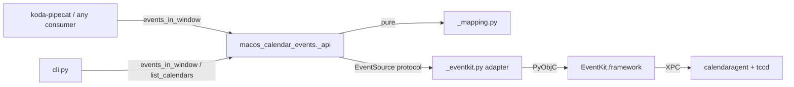
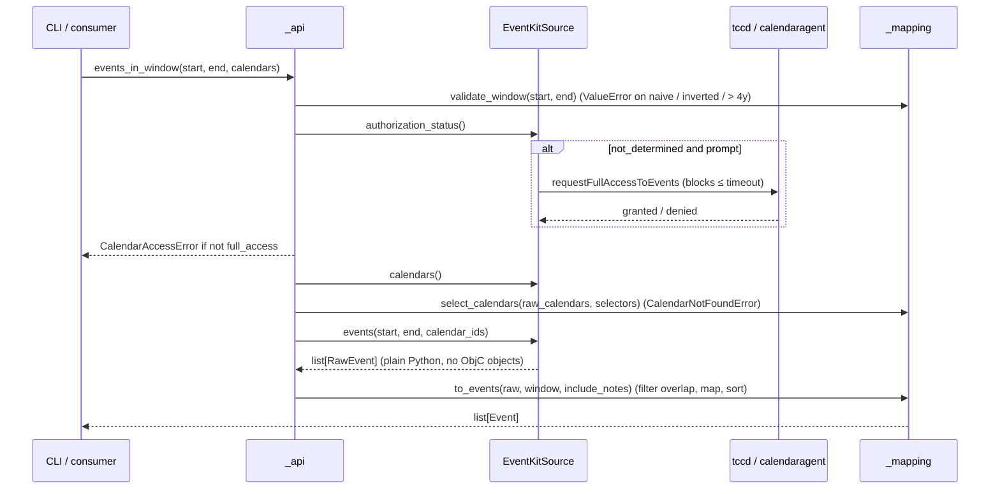

# Task: macos-calendar-events v0.1: read-only EventKit window query library and CLI

**Status**: Not Started
**Component**: core
**Assigned to**: Varun Singh (vr000m)
**Priority**: High
**Branch**: `feature/core-events-api` (suggested; repo is on `main` with only the initial commit, so branch before Phase 1)
**Created**: 2026-11-19
**Completed**:
**Review Gates**: none

## Objective

Ship an open-source Python package, `macos-calendar-events` (import name `macos_calendar_events`), that reads macOS Calendar through EventKit, read-only. It returns every event that overlaps a time window, across every calendar the Mac can see, as plain JSON-serializable dataclasses, through a small library API and a JSON CLI.

## Context

- **Motivation (consumer, not scope):** koda-pipecat records meetings, diarizes speakers (S1, S2, …), and post-processes each session. It wants to fetch calendar events in a fuzzy window around a recording (for example ±15 min), work out which of several overlapping meetings was actually attended, and use the invitee list as a *non-normative* hint, mostly for spelling speaker names. All of that ranking, matching, and LLM reconciliation stays in koda-pipecat. This package only answers "what events overlap [start, end)?" accurately and completely.
- **Why a separate repo:** it's reusable outside koda, it's open source, and it keeps PyObjC/EventKit and macOS privacy (TCC) concerns out of the consumer.
- **Data reality:** the user's Calendar.app aggregates several accounts (work Exchange/Google, personal iCloud, shared and subscribed calendars). EventKit exposes them all through one `EKEventStore`, so "all calendars" is the default.
- **Repo state (verified 2026-11-19):** branch `main`, one commit `4568144 Initial commit`, files `LICENSE` (**BSD 2-Clause**, © 2026 Varun Singh) and a stock Python `.gitignore` (already ignores `.venv`, `.mypy_cache`; leaves `uv.lock` tracked). No `pyproject.toml` yet. Dev machine: macOS 26.6.2, uv 0.9.18. Latest `pyobjc-framework-EventKit` on PyPI is 13.0 (`requires_python >=3.11`).

## Requirements

### Functional
- R1. `events_in_window(start, end, *, calendars=None, include_notes=False) -> list[Event]` returns every event overlapping the half-open window `[start, end)` from all calendars by default. `calendars` optionally restricts the query to calendars matched by exact identifier or by title (see R6).
- R2. `list_calendars() -> list[CalendarInfo]` returns every event calendar EventKit exposes: id, title, source title, source type, color hex, immutability flag.
- R3. `Event` fields: `id`, `external_id`, `event_identifier`, `title`, `start`, `end` (tz-aware), `all_day`, `time_zone` (IANA name or `None` for floating), `location`, `url`, `notes` (only when `include_notes=True`, else `None`), `status` (none/confirmed/tentative/canceled), `is_recurring`, `is_detached`, `occurrence_start`, `organizer: Participant | None`, `attendees: tuple[Participant, ...]`, `self_status: ParticipationStatus | None`, `calendar: CalendarRef` (id, title, source title).
- R4. `Participant`: `name | None`, `email | None` (parsed from `mailto:` only), `url | None` (raw participant URL when it isn't mailto), `role`, `status`, `type` (person/room/resource/group/unknown), `is_self`.
- R5. Declined and canceled events **are returned** with their status. Consumers decide what to drop.
- R6. Calendar filter: each selector matches by exact `calendarIdentifier` first, otherwise by title compared with `casefold()`. A title can match several calendars (for example "Calendar" in both iCloud and Exchange), and all of them are included. A selector that matches nothing raises `CalendarNotFoundError` listing the available titles. The filter is **never** silently ignored.
- R7. CLI `macos-calendar-events window --start ISO --end ISO [--calendar X ...] [--pad-minutes N] [--include-notes]` and `macos-calendar-events calendars`. Output is JSON on stdout, diagnostics go to stderr, and exit codes are documented (R11).
- R8. Output is deterministic: events sorted by `(start, end, calendar.id, id)`.

### Permissions (TCC)
- R9. `authorization_status() -> AccessStatus` (`not_determined | restricted | denied | full_access | write_only`). `request_access(timeout=60.0) -> AccessStatus` uses `requestFullAccessToEventsWithCompletion_` when the store responds to it (macOS 14+), otherwise `requestAccessToEntityType_completion_`. Reads call `ensure_access(prompt: bool)`: `full_access` passes, `not_determined` prompts (library default `prompt=True`), and anything else raises `CalendarAccessError(status)` with remediation text (System Settings → Privacy & Security → Calendars, naming the *responsible app*, e.g. Terminal/iTerm/VS Code, not "python"). `write_only` counts as denied for reads.
- R10. No writes, ever. The package never calls `saveEvent`, `removeEvent`, `commit`, or any mutating EventKit API (enforced by a grep check in CI, see Phase 1).

### Boundaries and errors
- R11. CLI exit codes: `0` ok, `2` usage/argument error (argparse default), `3` calendar access not granted, `4` EventKit unavailable (not macOS, or PyObjC missing), `5` calendar selector not found. Every non-zero exit prints one human-readable line to stderr and nothing to stdout.
- R12. The library API rejects naive datetimes (`ValueError`). The CLI parses ISO 8601 (`Z` or offset accepted) and treats a naive value as **local time**, and says so in `--help`. `end <= start` → `ValueError` / exit 2.
- R13. Window span cap: EventKit's `predicateForEventsWithStartDate:endDate:calendars:` only matches events within a four-year span. Windows longer than 4×365 days raise `ValueError` rather than silently truncating. No chunking in v0.1 (consumer windows are minutes to days).
- R14. `import macos_calendar_events` must succeed on non-macOS / without PyObjC (so tooling and docs builds work). EventKit is imported lazily, and only `_eventkit.py` imports `EventKit`/`Foundation`/`objc`.

### Packaging and quality
- R15. `pyproject.toml` (hatchling backend), `uv`-managed, `requires-python = ">=3.11"`, runtime dependency `pyobjc-framework-EventKit>=11; sys_platform == 'darwin'`. Tooling: ruff (lint + format), mypy `--strict` (one type checker; pyright not added), pytest. `py.typed` shipped. License metadata `BSD-2-Clause` to match `LICENSE`.
- R16. Privacy: no real calendar data in the repo, in test output, or in CI logs. Fixtures are hand-written with RFC 2606 domains (`example.com`, `example.org`). The live smoke test asserts structural invariants only and never prints titles, names, emails, or notes.
- R17. CI: GitHub Actions on a macOS runner runs ruff, mypy, and unit tests (`-m "not live"`). No live calendar access in CI.

## Non-Goals

- Ranking, scoring, fuzzy matching, or choosing "the" meeting. No LLM calls. (These belong to koda-pipecat.)
- Writing, editing, or deleting events, reminders (`EKEntityTypeReminder`), alarms, or attachments.
- Non-EventKit sources (ICS URLs, CalDAV, Google/Microsoft APIs). A future `calendar-window`-style multi-backend is out of scope.
- Change notifications (`EKEventStoreChangedNotification`), caching, daemons.
- Detecting calendars that are *hidden* (unchecked) in Calendar.app. EventKit doesn't expose that view state, so hidden-but-subscribed calendars are returned. This is documented and the `calendars` filter is the workaround.
- Windows > 4 years (R13), Python < 3.11, publishing to PyPI (release is a follow-up plan).

## Review Focus

- **EventKit contracts** (Apple Developer docs): `EKEventStore.requestFullAccessToEventsWithCompletion:` (macOS 14+) vs `requestAccessToEntityType:completion:` (deprecated in 14); `EKAuthorizationStatus` values (`FullAccess`=3 replaced `Authorized` on 14+, `WriteOnly`=4); `predicateForEventsWithStartDate:endDate:calendars:` four-year limit, and that `eventsMatchingPredicate:` expands recurring occurrences; `EKEvent.occurrenceDate`, `isDetached`, `calendarItemExternalIdentifier` (may be nil or shared across occurrences and across calendars for the same invite), `eventIdentifier` (shared by all occurrences); `EKParticipant.URL`, `participantRole/Status/Type`, `isCurrentUser`.
- **TCC attribution:** a CLI run from Terminal is attributed to the *responsible app* (Terminal, iTerm2, VS Code, cron → none). The prompt needs `NSCalendarsFullAccessUsageDescription` in the responsible app's Info.plist, and that may be missing for some terminals. **This is the highest risk and is de-risked in Phase 0 before any design is frozen.**
- **Completion-handler threading:** the EventKit completion block fires on an arbitrary queue. Verify that blocking on `threading.Event` with a timeout works from a plain CLI without pumping an `NSRunLoop`.
- **Time:** RFC 3339 output; DST transitions; floating (no-tz) events; all-day end exclusivity.
- **Formats:** RFC 6068 (`mailto:`) parsing for attendee emails; RFC 2606 fixture domains.
- **Overlap semantics** at boundaries, including zero-duration events.

## Architecture & Call Flow

> **Pending user confirmation** (skein gate: confirm topology before implementation). Independently executing components: consumer process (CLI or koda-pipecat), this library, Apple's EventKit framework in-process, and the out-of-process calendar agent plus TCC daemon.





## Implementation Checklist

Each phase ends in a green, checkable state. Don't start the next phase until the current phase's test and validation commands pass on the Mac.

### Phase 0: EventKit and TCC spike (throwaway, decides the design)

**Impl files:** `scripts/spike_eventkit.py`
**Test files:** (none: manual spike)
**Test command:** `uv run --with pyobjc-framework-EventKit python scripts/spike_eventkit.py --summary`
**Goal:** Turn the riskiest assumptions into observed facts before freezing types. The spike prints **counts and shapes only**, never titles, names, emails, or notes.

- From Terminal.app (and once from the user's usual terminal or VS Code), check `authorizationStatusForEntityType_`, call the macOS 14+ request API, and record whether a prompt appears and which app it names. If no prompt appears and the status stays denied, record that and decide the fallback (document "grant to your terminal", or ship a tiny signed helper `.app` in a follow-up plan).
- Confirm that blocking on `threading.Event.wait(timeout)` receives the completion callback without an `NSRunLoop`. If it doesn't, switch to pumping `NSRunLoop.currentRunLoop().runUntilDate_` in short slices.
- Over a real ±7-day window, record **shapes**: share of events with nil `calendarItemExternalIdentifier`; whether recurring occurrences share the external id; whether the same invite in two calendars shares an external id; the distribution of participant URL schemes (`mailto`, `urn`, `http`, other); all-day `startDate`/`endDate` representation (midnight to next midnight, or `23:59:59`); `timeZone` nil frequency; `participantType` values seen.
- Record findings in `## Findings` (Phase 0). Delete the spike script before Phase 6, or keep it under `scripts/` if it becomes the documented diagnostic (decide then).

### Phase 1: Scaffold, tooling, CI

**Impl files:** `pyproject.toml, src/macos_calendar_events/__init__.py, src/macos_calendar_events/py.typed, .github/workflows/ci.yml, scripts/check_readonly.sh`
**Test files:** `tests/test_import.py`
**Test command:** `uv run ruff check . && uv run ruff format --check . && uv run mypy && uv run pytest -m "not live"`
**Validation cmd:** `bash scripts/check_readonly.sh`
**Goal:** Every later phase lands on a working lint/type/test harness. The package imports without PyObjC.

- `pyproject.toml`: hatchling, src layout, `[project.scripts] macos-calendar-events = "macos_calendar_events.cli:main"`, `[dependency-groups] dev = [pytest, ruff, mypy]`, ruff config (target py311, `select = ["E","F","I","B","UP","SIM","RUF"]`), mypy `strict = true`, `files = ["src", "tests"]` with an override `ignore_missing_imports` for `EventKit`, `Foundation`, `objc`. pytest `markers = ["live: touches the real macOS calendar; opt-in"]`.
- `tests/test_import.py`: `import macos_calendar_events` succeeds and exposes `__version__`, with no EventKit import side effect (assert `"EventKit" not in sys.modules`).
- `scripts/check_readonly.sh`: `grep -nE 'saveEvent|removeEvent|saveCalendar|removeCalendar|commit_' src/` must find nothing (R10).
- CI: `macos-latest`, `astral-sh/setup-uv`, matrix Python 3.11 and 3.13, run the Test command and the read-only check. Commit `uv.lock`.

### Phase 2: Domain types and JSON

**Impl files:** `src/macos_calendar_events/models.py, src/macos_calendar_events/errors.py, src/macos_calendar_events/__init__.py`
**Test files:** `tests/test_models.py`
**Test command:** `uv run pytest tests/test_models.py -v && uv run mypy`
**Goal:** The public data shape is fixed and serializes to a stable, documented JSON form (schema_version 1).

- Frozen, slotted dataclasses and `StrEnum`s per the type sketch below. Collections are tuples (hashable, immutable).
- `Event.to_dict()` / `CalendarInfo.to_dict()` produce JSON-native values: datetimes as RFC 3339 strings with offset, enums as their string value, `None` kept as `null` (keys always present so consumers don't need `.get`).
- `to_json(events) -> str` wrapper: `{"schema_version": 1, "window": {"start": …, "end": …}, "events": [...]}`.
- Errors: `MacosCalendarEventsError` base; `CalendarAccessError(status: AccessStatus)`, `CalendarNotFoundError(selectors, available_titles)`, `EventKitUnavailableError`.
- Tests: hand-written expected dicts derived from the spec (not from calling the code), `json.loads(to_json(...))` round trip, and a frozen-mutation attempt raising `FrozenInstanceError`.

### Phase 3: Pure core (mapping, window, selection) against a fake source

**Impl files:** `src/macos_calendar_events/_raw.py, src/macos_calendar_events/_mapping.py, src/macos_calendar_events/_api.py`
**Test files:** `tests/fakes.py, tests/test_window_query.py, tests/test_calendar_selection.py`
**Test command:** `uv run pytest tests/test_window_query.py tests/test_calendar_selection.py -v && uv run mypy`
**Goal:** All behavior that isn't "talk to EventKit" is a pure function, exercised through `query_events(source, ...)` / `query_calendars(source, ...)` with a `FakeSource`. No PyObjC is touched.

- `_raw.py`: the `EventSource` Protocol plus `RawCalendar` / `RawEvent` / `RawParticipant` (plain Python: epoch floats or aware UTC datetimes, raw EventKit enum ints, strings, `None`). This is the adapter boundary contract.
- `_mapping.py`: `validate_window`, `select_calendars`, `overlaps`, `make_event_id`, `map_participant` (mailto parsing, role/status/type int → enum, unknown int → `UNKNOWN`), `map_event`, `to_events` (map → overlap filter → sort).
- `_api.py`: `query_events(source, start, end, *, calendars, include_notes, prompt)` and `query_calendars(source, *, prompt)`, which run access check → select → fetch → map. The public `events_in_window` / `list_calendars` in `__init__` call these with the default `EventKitSource`.
- Fixture-driven cases (each a named test asserting observable output):
  - overlap: event ends exactly at window start → excluded; starts exactly at window end → excluded; spans the whole window → included; zero-duration event at window start → included, at window end → excluded.
  - recurring: two occurrences of one series get distinct `id`s, the same `event_identifier`, and `is_recurring=True`; a detached occurrence keeps the id derived from its *original* `occurrence_start`.
  - all-day: `all_day=True`, start at local midnight, end exclusive (normalized per Phase 0 finding), `time_zone=None`.
  - DST: an event across the US spring-forward/fall-back boundary keeps the correct UTC instants and the offset in the event's `time_zone`.
  - declined: event with self attendee status `declined` is returned and `self_status == DECLINED`; canceled event is returned with `status == CANCELED`.
  - attendees: no email (non-mailto URL) → `email=None`, `url` kept; no name → `name=None`; organizer-only event → `attendees == ()`, organizer present; room resource → `type == ROOM`.
  - nil external id → `id` falls back to `event_identifier`.
  - same invite in two calendars → two events, distinct `id`, equal `external_id`.
  - selection: id match, case-insensitive title match, duplicate titles across sources both selected, unknown selector → `CalendarNotFoundError` with available titles, `calendars=None` → all.
  - window validation: naive → `ValueError`; `end <= start` → `ValueError`; > 4 years → `ValueError`.
  - access: fake returning each `AccessStatus`. Only `full_access` proceeds; `not_determined` + `prompt=False` raises; `not_determined` + `prompt=True` calls `request_access` once (asserted via the fake's recorded requests, an effect on the outside system).
  - `include_notes=False` → `notes is None` even when the raw event has notes.
  - ordering is deterministic across shuffled raw input.

### Phase 4: EventKit adapter and access

**Impl files:** `src/macos_calendar_events/_eventkit.py`
**Test files:** `tests/test_live_smoke.py`
**Test command:** `uv run pytest -m "not live" && uv run mypy`
**Validation cmd:** `MACOS_CALENDAR_EVENTS_LIVE=1 uv run pytest -m live -v`
**Goal:** A thin, logic-free translation from EventKit objects to `Raw*` records. Every decision lives in `_mapping`. Only this module imports PyObjC.

- `EventKitSource` implements `EventSource`: holds one `EKEventStore`; `authorization_status()`; `request_access(timeout)` (selector chosen by `respondsToSelector_`, completion → `threading.Event`, with the run-loop strategy chosen in Phase 0; timeout → returns current status); `calendars()` via `calendarsForEntityType_(EKEntityTypeEvent)`; `events(start, end, calendar_ids)` via the predicate with `calendars=None` for all.
- NSDate ↔ datetime via `timeIntervalSince1970` / `NSDate.dateWithTimeIntervalSince1970_` (UTC-aware). `NSTimeZone.name()` → IANA string. Nil → `None`. Participant URL → `absoluteString()`.
- Lazy import: `default_source()` raises `EventKitUnavailableError` on non-darwin or `ImportError`.
- Live smoke (`@pytest.mark.live`, skipped unless `MACOS_CALENDAR_EVENTS_LIVE=1` **and** `sys.platform == "darwin"`): over now ± 7 days, assert `list_calendars()` is non-empty; every event has aware `start <= end`, overlaps the window, has a non-empty `id`, and `id`s are unique; `json.loads(to_json(...))` succeeds. Print only counts.

### Phase 5: CLI

**Impl files:** `src/macos_calendar_events/cli.py`
**Test files:** `tests/test_cli.py`
**Test command:** `uv run pytest tests/test_cli.py -v && uv run mypy`
**Validation cmd:** `uv run macos-calendar-events calendars | python3 -c "import json,sys; d=json.load(sys.stdin); print('calendars:', len(d['calendars']))"`
**Goal:** The CLI is a thin shell: parse → call the API → serialize → map exceptions to exit codes (R11). There's no logic of its own beyond padding and naive-time interpretation.

- `main(argv: Sequence[str] | None = None, *, source: EventSource | None = None) -> int`. `source` is the test seam and isn't exposed as a CLI flag.
- `window`: `--start`, `--end` (ISO 8601; naive = local), `--calendar` (repeatable), `--pad-minutes N` (int ≥ 0, widens both ends), `--include-notes`, `--no-prompt` (don't trigger the TCC prompt; useful for cron/launchd). Output: `to_json` with the *padded* window echoed.
- `calendars`: `{"schema_version": 1, "calendars": [...]}`.
- Tests via `main([...], source=FakeSource(...))` + `capsys`: stdout parses as JSON with the expected events; `--pad-minutes 15` includes an event 10 min before `--start`; each error class → its exit code, with empty stdout and a one-line stderr; `end <= start` → 2; naive input interpreted as local (test sets `TZ` via `time.tzset` fixture on POSIX).

### Phase 6: Docs and release readiness (no publish)

**Impl files:** `README.md, CHANGELOG.md`
**Test files:** (none)
**Test command:** `uv run ruff check . && uv run mypy && uv run pytest -m "not live"`
**Validation cmd:** `uv build && uvx --from dist/*.whl macos-calendar-events --help`
**Goal:** A stranger can install it, grant permission, and run it from the README alone. Every command in the README is executed verbatim on the Mac before this phase is marked done.

- README: what/why (consumer use case in one paragraph, ranking explicitly out of scope), install (`uv add` / `pipx`), permission walkthrough (responsible app, System Settings path, `--no-prompt`, how to reset during development with `tccutil reset Calendar <bundle-id>`, run by the user, never by the tool), Python API example, CLI examples, JSON schema v1 table, exit codes, known limitations (hidden calendars, 4-year cap, external-id caveats, floating times), privacy note, BSD-2-Clause.
- A short "consumer pattern" snippet: fetch `[t0-15m, t1+15m)` and reconcile in your own code.
- Resolve the Phase 0 spike script (delete or document).

## Technical Specifications

### Files to Modify
- `.gitignore`: no change expected (already covers `.venv`, `.mypy_cache`, `dist/`; `uv.lock` stays tracked).

### New Files to Create
- `pyproject.toml`, `uv.lock`: packaging and tooling.
- `src/macos_calendar_events/__init__.py`: public API re-exports: `events_in_window`, `list_calendars`, `authorization_status`, `request_access`, models, errors, `__version__`.
- `src/macos_calendar_events/models.py`: domain dataclasses and enums.
- `src/macos_calendar_events/errors.py`: exception hierarchy.
- `src/macos_calendar_events/_raw.py`: `EventSource` Protocol and `Raw*` records (adapter contract).
- `src/macos_calendar_events/_mapping.py`: pure functions.
- `src/macos_calendar_events/_api.py`: orchestration over an `EventSource`.
- `src/macos_calendar_events/_eventkit.py`: the only PyObjC importer.
- `src/macos_calendar_events/cli.py`: argparse CLI.
- `src/macos_calendar_events/py.typed`
- `tests/fakes.py`, `tests/test_*.py`: fakes and tests (fictional data only).
- `scripts/check_readonly.sh`, `scripts/spike_eventkit.py` (temporary).
- `.github/workflows/ci.yml`, `README.md`, `CHANGELOG.md`.

### Type and Signature Sketch

```python
# models.py
class AccessStatus(StrEnum): NOT_DETERMINED="not_determined"; RESTRICTED="restricted"; DENIED="denied"; FULL_ACCESS="full_access"; WRITE_ONLY="write_only"
class EventStatus(StrEnum): NONE="none"; CONFIRMED="confirmed"; TENTATIVE="tentative"; CANCELED="canceled"
class ParticipationStatus(StrEnum): UNKNOWN="unknown"; PENDING="pending"; ACCEPTED="accepted"; DECLINED="declined"; TENTATIVE="tentative"; DELEGATED="delegated"; COMPLETED="completed"; IN_PROCESS="in_process"
class ParticipantRole(StrEnum): UNKNOWN="unknown"; REQUIRED="required"; OPTIONAL="optional"; CHAIR="chair"; NON_PARTICIPANT="non_participant"
class ParticipantType(StrEnum): UNKNOWN="unknown"; PERSON="person"; ROOM="room"; RESOURCE="resource"; GROUP="group"

@dataclass(frozen=True, slots=True)
class Participant:
    name: str | None; email: str | None; url: str | None
    role: ParticipantRole; status: ParticipationStatus; type: ParticipantType; is_self: bool

@dataclass(frozen=True, slots=True)
class CalendarRef:
    id: str; title: str; source_title: str

@dataclass(frozen=True, slots=True)
class CalendarInfo:
    id: str; title: str; source_title: str; source_type: str; color_hex: str | None; read_only: bool
    def to_dict(self) -> dict[str, object]: ...

@dataclass(frozen=True, slots=True)
class Event:
    id: str                 # unique per returned row: f"{calendar.id}:{external_id or event_identifier}:{occurrence_start UTC RFC3339}"
    external_id: str | None # calendarItemExternalIdentifier; same invite across calendars → equal (consumer may dedupe)
    event_identifier: str   # EKEvent.eventIdentifier; shared by occurrences of a series
    title: str
    start: datetime; end: datetime          # tz-aware; end exclusive
    all_day: bool; time_zone: str | None
    location: str | None; url: str | None; notes: str | None
    status: EventStatus
    is_recurring: bool; is_detached: bool; occurrence_start: datetime
    organizer: Participant | None
    attendees: tuple[Participant, ...]
    self_status: ParticipationStatus | None
    calendar: CalendarRef
    def to_dict(self) -> dict[str, object]: ...

def to_json(events: Sequence[Event], *, window: tuple[datetime, datetime]) -> str: ...

# _raw.py  (adapter boundary; no ObjC types cross it)
class EventSource(Protocol):
    def authorization_status(self) -> AccessStatus: ...
    def request_access(self, timeout: float) -> AccessStatus: ...
    def calendars(self) -> Sequence[RawCalendar]: ...
    def events(self, start: datetime, end: datetime, calendar_ids: Sequence[str] | None) -> Sequence[RawEvent]: ...

# _mapping.py  (pure)
def validate_window(start: datetime, end: datetime) -> None: ...
def select_calendars(cals: Sequence[RawCalendar], selectors: Sequence[str] | None) -> list[RawCalendar]: ...
def overlaps(ev_start: datetime, ev_end: datetime, w_start: datetime, w_end: datetime) -> bool: ...
def to_events(raw: Sequence[RawEvent], window: tuple[datetime, datetime], *, include_notes: bool) -> list[Event]: ...

# __init__.py  (public)
def events_in_window(start: datetime, end: datetime, *, calendars: Sequence[str] | None = None,
                     include_notes: bool = False, prompt: bool = True) -> list[Event]: ...
def list_calendars(*, prompt: bool = True) -> list[CalendarInfo]: ...
def authorization_status() -> AccessStatus: ...
def request_access(timeout: float = 60.0) -> AccessStatus: ...
```

Overlap rule: `ev_start < w_end and ev_end > w_start`, plus the zero-duration case `ev_start == ev_end and w_start <= ev_start < w_end`. Applied in Python even though EventKit pre-filters, so the semantics don't depend on EventKit's edge behavior.

### Architecture Decisions
- **Adapter returns plain `Raw*` records (chosen) vs mapping over PyObjC objects (rejected).** Two shapes were sketched. (A) The mapping reads ObjC selectors directly, and fakes must mimic `title()`, `startDate()`, … (B) The adapter does dumb getter → `Raw*` conversion, and all logic is pure Python. B gives each piece of state one owner (EventKit facts live in `_eventkit`, decisions in `_mapping`), makes fakes trivial, and keeps ObjC out of the public surface. The cost is that the getter code is only covered by the live smoke test, which is acceptable because it is branch-free.
- **Return declined/canceled, never filter:** the consumer has context we lack (it may have attended a declined meeting).
- **`id` includes the calendar id** so rows are unique even when one invite appears in two calendars. `external_id` is exposed separately so koda can collapse duplicates if it wants.
- **Reject rather than chunk >4-year windows** (subtract before you add; no observed need).
- **Library `prompt=True` default, CLI `--no-prompt` opt-out:** interactive first use just works, and headless callers can avoid hanging on a prompt.
- **`notes` opt-in:** notes often carry dial-in codes and passcodes, so they're excluded unless asked for (see Open Questions).
- **One type checker (mypy strict):** pyright would duplicate the gate.

### Dependencies
- Runtime: `pyobjc-framework-EventKit>=11; sys_platform == 'darwin'` (brings `pyobjc-core`, `pyobjc-framework-Cocoa`). Dev: `pytest`, `ruff`, `mypy`. No other runtime deps (stdlib `argparse`, `json`, `zoneinfo`, `dataclasses`).

### Integration Seams

| Seam | Writer (task) | Caller (task) | Contract |
|------|---------------|---------------|----------|
| `EventSource` protocol / `Raw*` records | `_eventkit.py` (P4), `tests/fakes.py` (P3) | `_api.py` (P3) | No ObjC objects; datetimes UTC-aware; nil → `None`; enum fields are raw EventKit ints; `events()` with `calendar_ids=None` means all calendars |
| Access gate | `_api.py` (P3) | `__init__`, `cli.py` (P5) | Raises `CalendarAccessError(status)` unless `full_access`; prompts at most once per call and only when `prompt=True` |
| JSON schema v1 | `models.py` (P2) | CLI (P5), koda-pipecat (external) | Keys always present; RFC 3339 datetimes; enum string values; `schema_version` bumps on any breaking change |
| Exit codes | `cli.py` (P5) | shell / koda subprocess | R11 table; stdout empty on error |

## Testing Notes

### Test Approach
- Unit (CI + local): Phases 2, 3, and 5 through public or seam functions with `FakeSource`. Expected values come from the requirements, not from running the code.
- Live (local, opt-in): `MACOS_CALENDAR_EVENTS_LIVE=1 uv run pytest -m live`. Structural invariants only.
- Manual: Phase 0 spike; Phase 5 and 6 validation commands on the Mac.

### Edge Cases to Cover
- Recurring occurrences, detached occurrences; all-day (single and multi-day); DST boundaries; floating-time events; zero-duration events; declined/canceled; attendee without email or name; organizer-only; room/resource participants; nil external id; same invite in two calendars; duplicate calendar titles; read-only subscribed calendars (holidays, birthdays); unknown future EventKit enum ints → `UNKNOWN`; TCC `not_determined`/`denied`/`restricted`/`write_only`; prompt timeout; non-macOS import.

## Risks & Open Questions

- **Risk: no TCC prompt from some terminals** (responsible app lacks `NSCalendarsFullAccessUsageDescription`), leaving the status stuck at denied. *Mitigation:* Phase 0 tests it on macOS 26. Worst case, the README documents a terminal that works, and a follow-up plan ships a minimal helper `.app`.
- **Risk: completion handler never fires without a run loop.** *Mitigation:* Phase 0 decides the run-loop strategy, and the timeout guarantees no hang.
- **Risk: `calendarItemExternalIdentifier` instability** (Apple notes it can change for some sources, e.g. after sync). *Mitigation:* `id` falls back to `event_identifier`, docs say ids are best-effort stable, and the consumer shouldn't persist them as primary keys without tolerance.
- **Risk: PyObjC/macOS version drift** (EventKit API deprecations). *Mitigation:* `respondsToSelector_` gating, CI on `macos-latest`.
- **Q1 (user):** `notes` default-off with `--include-notes` opt-in. OK, or should notes be on by default for koda's topic matching?
- **Q2 (user):** Should `id` include the calendar id (current choice: unique rows, dedupe via `external_id`), or should duplicates be collapsed in the library?
- **Q3 (user):** Minimum macOS: plan targets 14+ for live testing, and the pre-14 request path is implemented but untested. Do you need macOS 13 support?
- **Q4 (user):** Plan directory: skein's convention is `docs/dev_plans/` (plural). You asked for `docs/dev_plan`. Keep the skein name (so `/plan-view` and `/conduct` find it) or rename?
- **Q5 (user):** Confirm the Architecture & Call Flow topology above (skein gate) before Phase 1.

## Acceptance Criteria

- `events_in_window` and `list_calendars` behave per R1–R8 and are proven by the Phase 3 named tests passing.
- Permission states behave per R9, with the live run on the Mac confirming `full_access` after the grant and the Phase 5 CLI exiting `3` with a remediation line when access is denied (simulated with `FakeSource`).
- `bash scripts/check_readonly.sh` passes (R10). No mutating EventKit call in `src/`.
- `import macos_calendar_events` works without PyObjC (R14), proven by `tests/test_import.py`.
- CI green on the macOS runner (ruff, mypy strict, unit tests) for Python 3.11 and 3.13.
- Live smoke passes on the user's Mac without printing calendar content.
- README commands executed verbatim on the Mac; `uv build` wheel runs `--help`.
- No real calendar data anywhere in the repo: `grep -rhoE '[A-Za-z0-9._%+-]+@[A-Za-z0-9.-]+\.[a-z]+' tests/ src/ README.md | grep -vE '@example\.(com|org)$'` prints nothing.

<!-- reviewed: YYYY-MM-DD @ <hash> -->
<!-- /review-plan writes the marker line above. Everything below is the workspace: edits here do NOT invalidate the marker. -->

## Progress

- [ ] Phase 0: EventKit and TCC spike
- [ ] Phase 1: Scaffold, tooling, CI
- [ ] Phase 2: Domain types and JSON
- [ ] Phase 3: Pure core against a fake source
- [ ] Phase 4: EventKit adapter and access
- [ ] Phase 5: CLI
- [ ] Phase 6: Docs and release readiness

## Findings

- (Phase 0 spike results go here: shapes and counts only, no calendar content.)

### Authoring self-review (2026-11-19, inline; not a `/review-plan` run)

This was an author-side pass over skein `review-plan`'s five lenses plus its contradiction pass, run inline by the author instead of in fresh-context agents. **It doesn't replace `/review-plan`. Run that before `/conduct`.** It doesn't write the review marker.

Fixed during the pass:
- *codebase-claims:* the license is **BSD-2-Clause**, not MIT, so it's now in R15 and the README. `requires-python` was raised to 3.11 to match PyObjC 13 (`>=3.11`).
- *assumptions:* "hidden calendars can be excluded" was false (EventKit has no visibility flag), so it moved to Non-Goals with a workaround. "External id is stable and unique" was false, so `id` now includes the calendar id plus an occurrence start, with an `event_identifier` fallback and a documented risk.
- *assumptions:* the 4-year predicate limit would silently truncate wide windows, so R13 now rejects them explicitly.
- *sequencing:* the TCC/run-loop unknowns could invalidate the adapter and CLI design, so they moved to a Phase 0 spike before the scaffold rather than being discovered in Phase 4.
- *spec-and-testing:* tests originally named internal helpers. They now drive `query_events` / `main(argv, source=)` and assert observable output and fake-recorded effects. Zero-duration and boundary overlap cases were added. The privacy rule for live tests is stated.
- *architecture:* two adapter shapes were compared and the plain-`Raw*` boundary was chosen. Only `_eventkit.py` imports PyObjC (R14), and the CLI has no logic of its own.
- *spec-and-testing (2nd pass):* the privacy acceptance check used `grep '@'`, which would match pytest decorators, so it's now an email-shaped regex excluding RFC 2606 domains.
- *contradiction pass:* the CLI's naive-datetime rule (local time) vs the library's (reject) is intentional and now stated in R12. Notes are listed in R3 but default-off, which is reconciled via `include_notes` and Q1.

Accepted / deferred: no window chunking; no helper `.app` (only if Phase 0 shows it's needed); pre-macOS-14 request path untested live (Q3).

## Issues & Solutions

## Final Results
